# Seguridad en Cúcuta del 7 de agosto al último corte oficial de 2026: 10 notas estadísticas con fuente oficial

*Documento preparado el 16 de noviembre de 2026. Todas las cifras se recalcularon ese día contra las fuentes oficiales y cada nota trae su constancia (captura de pantalla con URL, fecha y hora).*

## Alcance y método

Estas notas describen la criminalidad registrada en el municipio de San José de Cúcuta (código DANE 54001) y, cuando se indica, en su área metropolitana (Cúcuta, Villa del Rosario, Los Patios, El Zulia, San Cayetano y Puerto Santander). El periodo va desde el **7 de agosto de 2026** hasta la **última fecha de corte oficial disponible**. Ese corte depende de la fuente:

- **Ministerio de Defensa / Policía Nacional (SIEDCO).** Datasets publicados en datos.gov.co. Último hecho registrado: **30 de septiembre de 2026**. Actualización: 21 de octubre de 2026. Son datos por día, así que la ventana exacta es **7 de agosto a 30 de septiembre (55 días)**.
- **Fiscalía General de la Nación (SPOA).** Dataset «Procesos Fiscalía – V3» (`dbdv-iihs`). Corte declarado: **31 de octubre de 2026**. Actualización: 6 de noviembre de 2026. Solo informa el mes del hecho, así que la ventana es **agosto a octubre**, sin poder empezar el 7 de agosto.

**Comparación.** Siempre se compara con el mismo periodo de 2025. Para la Fiscalía se aplica además un control de **mismo rezago de registro**: de los hechos de agosto a octubre de 2025 solo se cuentan los procesos creados hasta octubre de 2025. Así los dos años tienen el mismo tiempo de denuncia (ver nota 6).

**Tasas.** Se usa la población oficial DANE (proyecciones municipales por área 2018-2042, «Actualizado el 30 de Julio de 2025», verificadas en el archivo oficial): Cúcuta **793.211 habitantes en 2025** y **792.180 en 2026**; área metropolitana 1.073.246 y 1.074.787. Las tasas de periodos cortos se anualizan multiplicando por 365/días. Son ilustrativas y volátiles.

**Por qué octubre y noviembre no tienen cifra desagregada.** Ninguna fuente oficial abierta publica todavía datos posteriores al 30 de septiembre con fecha exacta del hecho. El SPOA llega a octubre, pero solo por mes y con registro incompleto de los hechos más recientes. Para noviembre no hay ningún dato oficial abierto.

**Por qué Medicina Legal queda fuera.** Su dataset abierto de lesiones fatales (`2kpj-cktv`) llega solo a julio de 2026. Sus boletines PDF mensuales estaban bloqueados (HTTP 403, Cloudflare) y no se insistió.

**Qué no se usa.** No se usó prensa como base. Las cifras proceden de cálculos propios, reproducibles, sobre microdatos oficiales; las URL exactas de cada consulta están en el anexo.

---

## Nota 1. Homicidios en Cúcuta: 49 entre el 7 de agosto y el 30 de septiembre de 2026, frente a 59 en 2025 (−16,9 %)

Entre el 7 de agosto y el 30 de septiembre de 2026 la Policía Nacional registró **49 víctimas de homicidio intencional** en Cúcuta, frente a **59** en el mismo lapso de 2025. Son 10 menos, una reducción del **16,9 %**.

- **Por mes:** la baja ocurre en los dos meses. Del 7 al 31 de agosto hubo 28 casos (33 en 2025, −15,2 %) y en septiembre 21 (26 en 2025, −19,2 %).
- **Tasa:** el periodo equivale a 6,19 homicidios por 100.000 habitantes. Anualizada, es de **41,1 por 100.000**, frente a 49,4 en 2025.
- **Año corrido:** el periodo confirma la tendencia de enero a septiembre, con 212 casos frente a 246 (−13,8 %), es decir, una tasa anualizada de 35,8 frente a 41,5.

La reducción es real en el registro, pero el nivel sigue siendo alto: la tasa anualizada del periodo cuadruplica el umbral de 10 por 100.000 que la OMS usa como referencia de violencia epidémica. Agosto concentra más casos que septiembre en ambos años. Su tasa anualizada (51,6 en 2026) muestra que el arranque del periodo fue más violento que su cierre (32,3 en septiembre).

| Cúcuta (54001) | 2025 | 2026 | Var. | Tasa periodo 2025 → 2026 | Tasa anualizada 2025 → 2026 |
|---|---|---|---|---|---|
| 7–31 ago | 33 | 28 | −15,2 % | 4,16 → 3,53 | 60,7 → 51,6 |
| 1–30 sep | 26 | 21 | −19,2 % | 3,28 → 2,65 | 39,9 → 32,3 |
| **7 ago–30 sep (55 días)** | **59** | **49** | **−16,9 %** | **7,44 → 6,19** | **49,4 → 41,1** |
| Ene–sep (273 días) | 246 | 212 | −13,8 % | 31,0 → 26,8 | 41,5 → 35,8 |

**Fuente oficial.** Ministerio de Defensa Nacional, dataset «HOMICIDIO» (Observatorio MDN / Policía Nacional, SIEDCO), ID `m8fd-ahd9`.
- Dataset: https://www.datos.gov.co/Seguridad-y-Defensa/HOMICIDIO/m8fd-ahd9
- Último hecho: 30-sep-2026. Actualizado: 21-oct-2026. Consulta: 16-nov-2026.
- Población: DANE, PPED municipal por área 2018-2042 (actualizado el 30-jul-2025), https://www.dane.gov.co/files/censo2018/proyecciones-de-poblacion/Municipal/PPED-AreaMun-2018-2042_VP.xlsx

**Constancia**

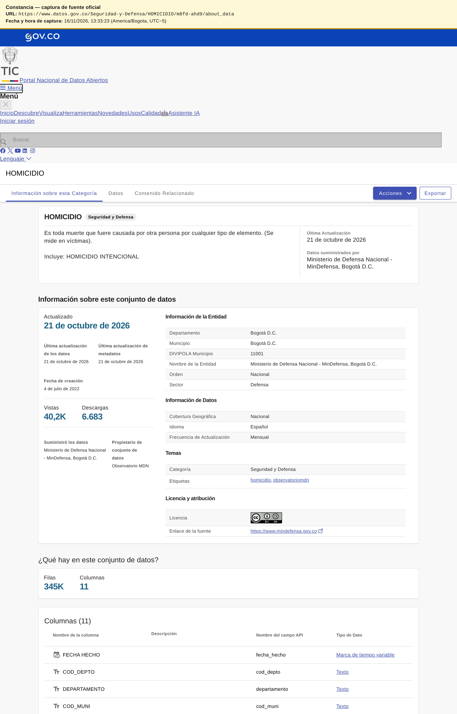
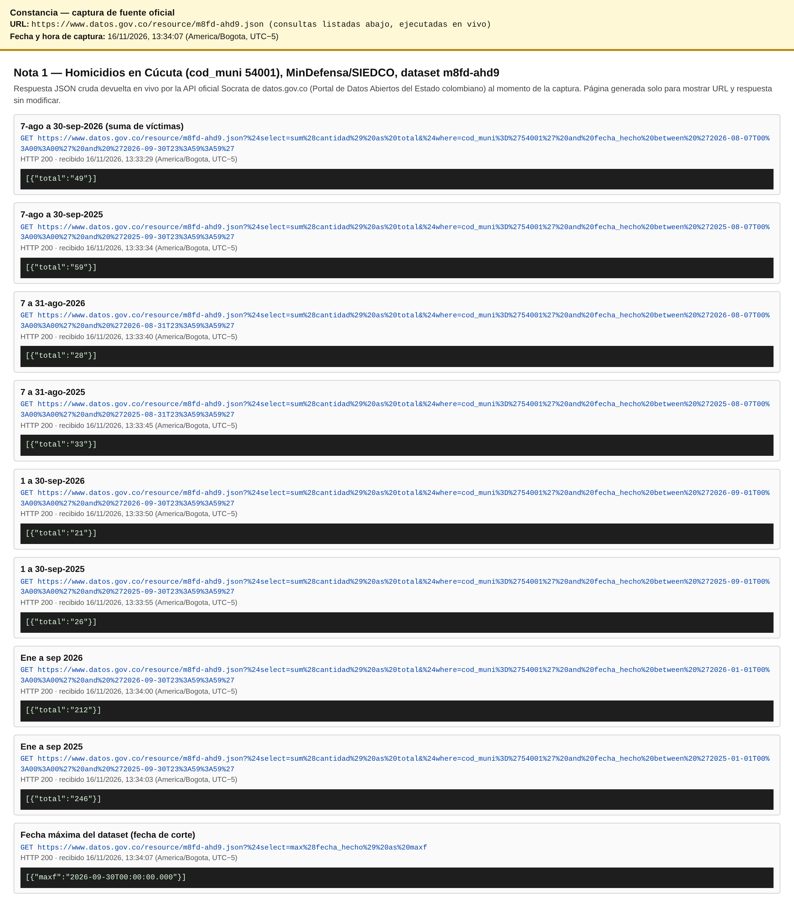
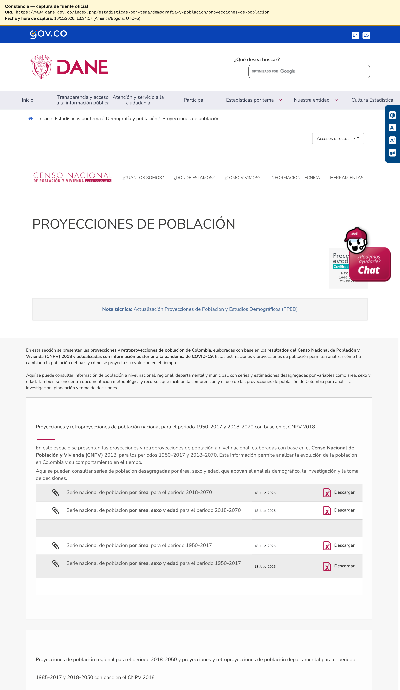
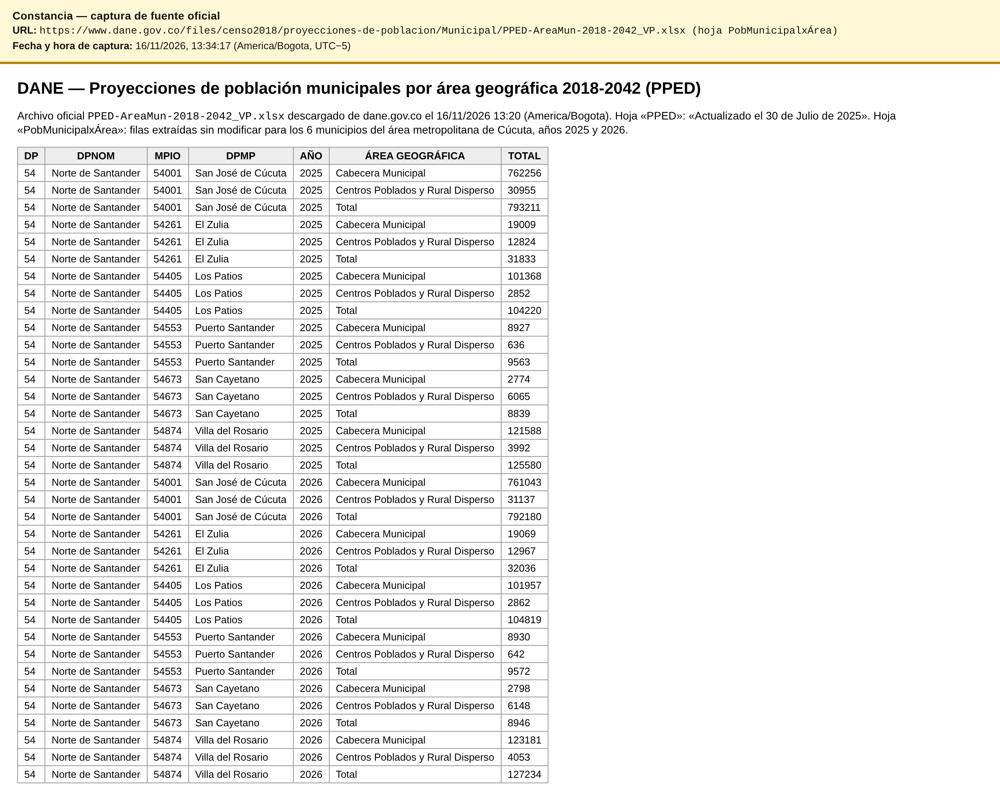

**Advertencias**
- La unidad es la víctima (suma de la columna `cantidad`).
- Se cuenta solo el homicidio intencional; los homicidios en accidente de tránsito van en otro dataset.
- Las cifras son preliminares y cambian con cada actualización mensual.
- Una tasa anualizada sobre 55 días es sensible a picos de pocos días y no es una proyección del año.
- No hay cifra oficial desagregada del 1 de octubre en adelante (ver nota 8 para un indicio del SPOA).

---

## Nota 2. Cómo se mata en Cúcuta: 84 % con arma de fuego y 71 % por sicariato; el sicariato baja más que el total

En el periodo de 2026, **41 de los 49 homicidios (83,7 %)** se cometieron con arma de fuego, una proporción casi igual a la de 2025 (50 de 59, 84,7 %).

**Sicariato.** La modalidad presunta «sicariato» sigue dominando con **35 casos (71,4 %)**, pero es la que más cae: había 49 en 2025 (83,1 %), es decir, −28,6 %. Le siguen las riñas (6 frente a 5) y los ataques atribuidos a grupos armados organizados, «atacados por GAO o GAO-R» (5 frente a 2), que se analizan en la nota 3.

**Hechos con un solo caso.** En 2026 hubo un homicidio con artefacto explosivo (modalidad «terrorismo»), uno de violencia intrafamiliar y uno «por establecer».

**Víctimas mujeres.** Los hombres siguen siendo casi todas las víctimas (43). Las mujeres pasan de 4 a **6** (de 6,8 % a 12,2 %). El dataset caracteriza **1 feminicidio** en el periodo de 2026 y ninguno en 2025.

**Zona.** Por zona, 44 casos fueron urbanos y 5 rurales (56 y 3 en 2025).

| Variable (7 ago–30 sep) | 2025 | 2026 |
|---|---|---|
| Arma de fuego | 50 | 41 |
| Arma blanca / cortopunzante | 6 | 6 |
| Contundentes | 3 | 1 |
| Artefacto explosivo | 0 | 1 |
| Modalidad: sicariato | 49 | 35 |
| Riñas | 5 | 6 |
| Atacados por GAO o GAO-R | 2 | 5 |
| Atraco | 2 | 0 |
| Otras (tortura, VIF, terrorismo, por establecer) | 1 | 3 |
| Víctimas mujeres | 4 | 6 |
| Feminicidio (caracterización SPOA) | 0 | 1 |
| Zona urbana / rural | 56 / 3 | 44 / 5 |

**Fuente oficial.** MinDefensa, dataset `m8fd-ahd9` (columnas `arma_medio`, `_modalidad_presunta`, `sexo`, `zona`, `spoa_caracterizacion`).
- Datos: https://www.datos.gov.co/Seguridad-y-Defensa/HOMICIDIO/m8fd-ahd9/data_preview
- Corte: 30-sep-2026. Consulta: 16-nov-2026.

**Constancia**

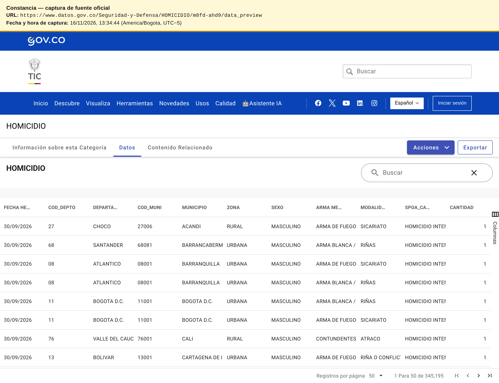
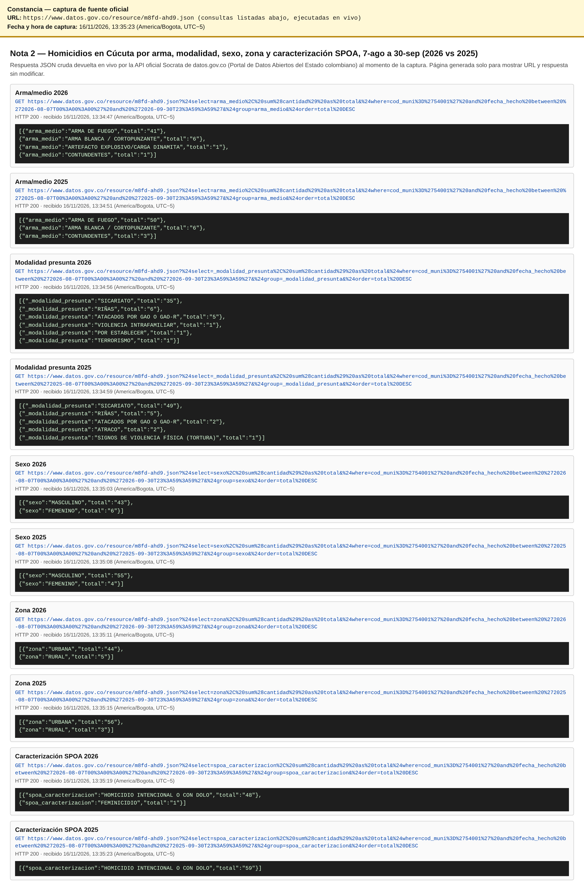

**Advertencias**
- La «modalidad presunta» es una clasificación policial inicial y puede cambiar con la investigación.
- Los subgrupos son pequeños: variaciones de 1 a 3 casos no son estadísticamente concluyentes.
- El dataset no trae edad, nacionalidad ni barrio.

---

## Nota 3. Huella de los grupos armados: 5 homicidios «atacados por GAO» en el periodo frente a 2 en 2025; en el año, 38 frente a 8

**En el periodo.** La modalidad «atacados por GAO o GAO-R» (grupos armados organizados y residuales) registró **5 víctimas en Cúcuta entre el 7 de agosto y el 30 de septiembre de 2026**, frente a 2 en 2025. Cuatro de las cinco fueron en **zona rural** (10, 29 [dos] y 30 de agosto); la otra fue urbana, el 19 de agosto. Todas eran hombres y todas murieron por arma de fuego. **En septiembre de 2026 no hubo ninguna.**

**En el año.** La serie de 2026 muestra un cambio de escala: **38 víctimas «por GAO» de enero a septiembre**, frente a 8 en el mismo lapso de 2025, con picos en abril (9) y junio (8). Lo mismo ocurre en lo rural: **37 de los 212 homicidios de 2026 (17,5 %) ocurrieron en zona rural**, frente a 9 de 246 (3,7 %) en 2025.

**Tasas por zona.** Con la población DANE de centros poblados y rural disperso (31.137 habitantes en 2026), la tasa rural anualizada de enero a septiembre es de **158,9 por 100.000**, frente a 30,7 en la cabecera. En el periodo de 55 días la brecha persiste: 106,6 rural frente a 38,4 urbana.

**Fuera de Cúcuta.** Fuera del municipio la modalidad también sube. El Zulia registró 2 casos «por GAO» en el periodo (1 en 2025) y Norte de Santander en conjunto **33 frente a 8**.

**Lectura.** El homicidio total cae (nota 1), pero la violencia atribuida a grupos armados crece y se concentra en la periferia rural de Cúcuta y en el corredor hacia El Zulia. Es coherente con el traslado de la confrontación del Catatumbo que describe la Defensoría (nota 10). El periodo de 2026 aparece como continuación de ese patrón, con agosto activo y septiembre en cero.

| «Atacados por GAO o GAO-R» y zona rural | 2025 | 2026 |
|---|---|---|
| GAO, Cúcuta, 7 ago–30 sep | 2 | 5 (4 rurales) |
| Homicidios rurales, Cúcuta, 7 ago–30 sep | 3 | 5 |
| GAO, Cúcuta, ene–sep | 8 | 38 |
| Homicidios rurales, Cúcuta, ene–sep | 9 | 37 |
| GAO, El Zulia, 7 ago–30 sep | 1 | 2 |
| GAO, Norte de Santander, 7 ago–30 sep | 8 | 33 |
| GAO, Cúcuta, por mes 2026 (ene a sep) | — | 2, 5, 3, 9, 2, 8, 4, 5, 0 |

**Fuente oficial.** MinDefensa, dataset `m8fd-ahd9`. Filtro: `_modalidad_presunta='ATACADOS POR GAO O GAO-R'` y `zona='RURAL'`. Corte: 30-sep-2026. Consulta: 16-nov-2026. Población rural: DANE PPED (actualizado el 30-jul-2025).

**Constancia**

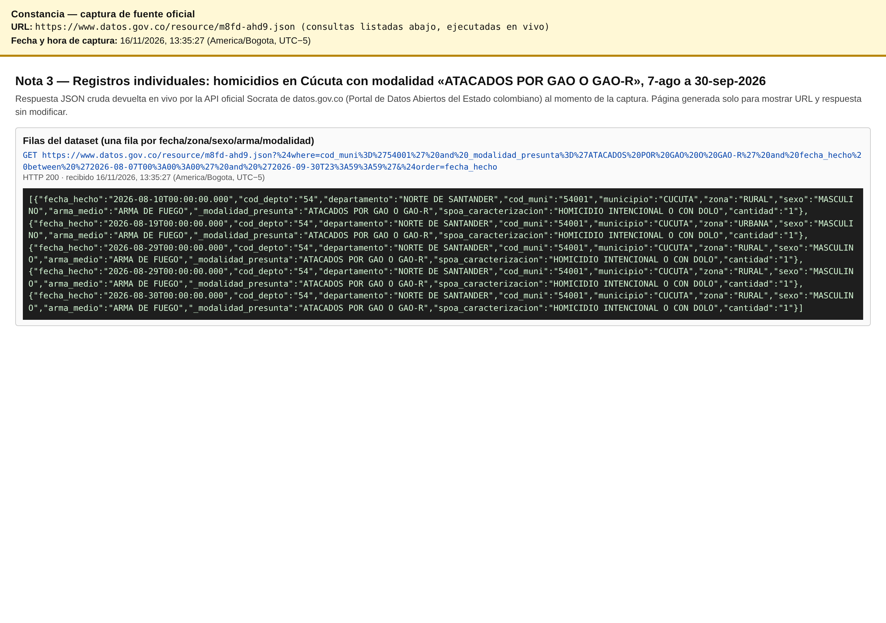
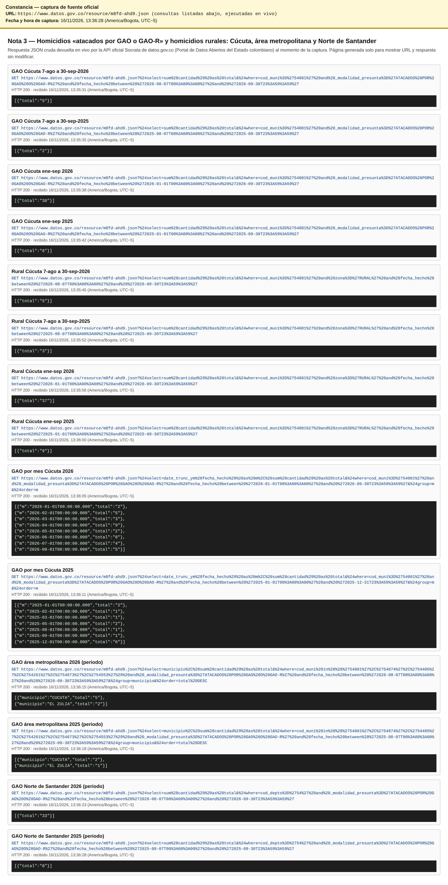

**Advertencias**
- La atribución a un GAO es presunta e inicial y no identifica qué grupo actuó.
- Con conteos de un dígito, la variación porcentual del periodo (+150 %) es frágil. Lo robusto es el cambio de nivel del año.
- La «zona rural» de la Policía y el «centro poblado y rural disperso» del DANE no son definiciones idénticas, así que la tasa rural es aproximada.

---

## Nota 4. Área metropolitana: 60 homicidios frente a 72 (−16,7 %), aunque Los Patios pasa de 1 a 4 y el departamento sube

**El área en conjunto.** Los seis municipios del área metropolitana sumaron **60 homicidios** del 7 de agosto al 30 de septiembre de 2026, frente a 72 en 2025 (−16,7 %). La tasa anualizada pasa de 44,5 a **37,1 por 100.000**. Cúcuta explica casi toda la caída (−10).

**Los Patios.** Es la excepción: pasa de 1 a **4** homicidios. En el mismo periodo concentró **3 de los 6 registros de terrorismo** del área y **7 miembros de la Fuerza Pública heridos**, el único registro de afectación a uniformados en el área en esos 55 días.

**El Zulia y otros municipios.** El Zulia baja de 8 a 5, pero 2 de esos 5 se atribuyen a GAO. Villa del Rosario baja de 3 a 2.

**Año corrido.** De enero a septiembre, el área baja menos que Cúcuta (294 frente a 314, −6,4 %). Villa del Rosario (31 frente a 25) y Los Patios (19 frente a 9) suben en el año.

**Norte de Santander.** En el periodo el departamento registró **104 homicidios frente a 99 (+5,1 %)**. Cúcuta mejora mientras el resto del departamento empeora.

| Municipio (7 ago–30 sep) | 2025 | 2026 | Ene–sep 2025 | Ene–sep 2026 |
|---|---|---|---|---|
| Cúcuta | 59 | 49 | 246 | 212 |
| El Zulia | 8 | 5 | 25 | 23 |
| Los Patios | 1 | 4 | 9 | 19 |
| Villa del Rosario | 3 | 2 | 25 | 31 |
| Puerto Santander | 1 | 0 | 4 | 6 |
| San Cayetano | 0 | 0 | 5 | 3 |
| **Área metropolitana** | **72** | **60** | **314** | **294** |
| Terrorismo (registros), área | 12 | 6 | — | — |
| Fuerza Pública herida, área | 1 (V. del Rosario) | 7 (Los Patios) | — | — |
| Norte de Santander (homicidios) | 99 | 104 | — | — |

**Fuente oficial.**
- MinDefensa, datasets `m8fd-ahd9` (homicidio), `yi5j-5fe9` (terrorismo) y `8rpn-wpty` (afectación a miembros de la Fuerza Pública). Corte: 30-sep-2026. Actualizados: 21-oct-2026.
- Población: DANE PPED municipal.
- Consulta: 16-nov-2026.

**Constancia**

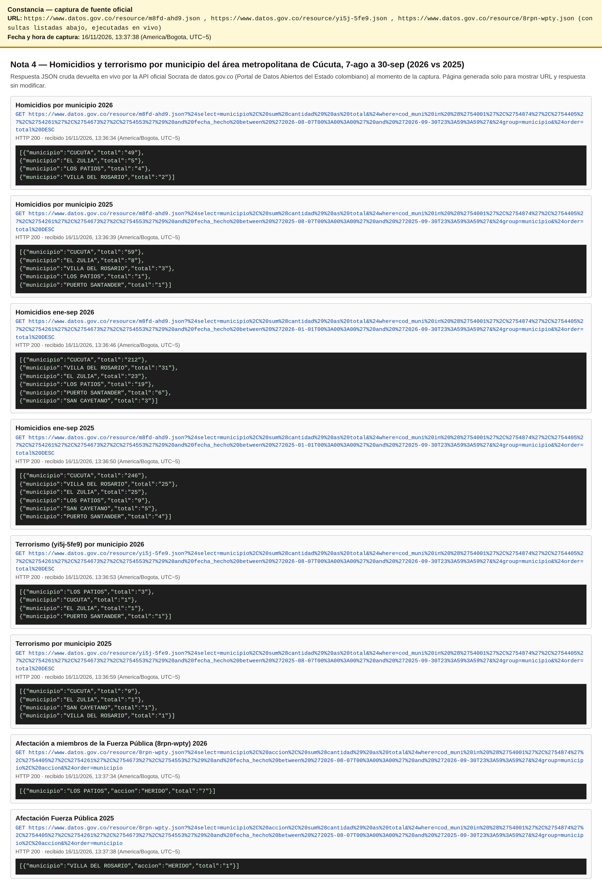

**Advertencias**
- Las tasas municipales de los municipios pequeños no se publican porque con 0 a 5 casos son inestables.
- «Terrorismo» y «afectación a Fuerza Pública» cuentan registros, no eventos únicos. Un mismo atentado puede generar varios.
- No hay datos oficiales posteriores al 30 de septiembre.

---

## Nota 5. Hurtos: el hurto a personas sube de 333 a 563 (+69 %) y el de motos de 85 a 182 (+114 %), con un salto de registro desde junio

Del 7 de agosto al 30 de septiembre de 2026 se registraron en Cúcuta **563 hurtos a personas**, frente a 333 en 2025 (+69,1 %; tasa del periodo de 71,1 frente a 42,0 por 100.000).

**Motocicletas.** El hurto de motos se duplicó con creces: **182 frente a 85 (+114,1 %)**.

**Otras modalidades.** Bajó el hurto de automotores (6 frente a 13). El de comercio (40 frente a 38) y el de residencias (45 frente a 40) se mantuvieron casi estables.

**Hurto a personas: el salto es de registro.** La serie mensual muestra que el alza **no es gradual**. De enero a mayo de 2026 el hurto a personas estuvo *por debajo* de 2025 (128 a 185 casos al mes, frente a 202 a 215). En junio saltó a 318 y desde entonces se mantiene entre 318 y 397 al mes. Un escalón tan abrupto y sostenido es típico de un cambio en la captura o integración de denuncias, no de una ola delictiva que empiece de un mes a otro. No se encontró nota técnica oficial que lo explique.

**Motos: el alza parece real.** En cambio, el hurto de motos sube de forma más progresiva: 40 a 65 al mes en el primer trimestre, 82 a 89 de abril a junio y 92 a 105 en agosto y septiembre. Esa trayectoria es más compatible con un aumento real.

| Cúcuta, MinDefensa (7 ago–30 sep) | 2025 | 2026 | Var. | Tasa 2025 → 2026 | Ene–sep 2025 → 2026 |
|---|---|---|---|---|---|
| Hurto a personas | 333 | 563 | +69,1 % | 42,0 → 71,1 | 1.770 → 2.136 (+20,7 %) |
| Hurto de motocicletas | 85 | 182 | +114,1 % | 10,7 → 23,0 | 482 → 677 (+40,5 %) |
| Hurto de automotores | 13 | 6 | −53,8 % | 1,6 → 0,8 | 48 → 53 |
| Hurto a comercio | 38 | 40 | +5,3 % | 4,8 → 5,0 | 270 → 203 (−24,8 %) |
| Hurto a residencias | 40 | 45 | +12,5 % | 5,0 → 5,7 | 194 → 163 (−16,0 %) |
| Hurto a personas por mes, 2026 (ene a sep) | | | | | 142, 143, 167, 128, 185, **318, 397, 327, 329** |

**Fuente oficial.**
- MinDefensa, datasets «HURTO PERSONAS» `4rxi-8m8d`, «HURTO A VEHÍCULOS» `csb4-y6v2` (artículo 239, motocicletas y automotores), «HURTO A COMERCIO» `7i2x-h5vp` y «HURTO A RESIDENCIAS» `7mn7-vzqp`.
- Corte: 30-sep-2026. Actualizados: 21-oct-2026. Consulta: 16-nov-2026.

**Constancia**

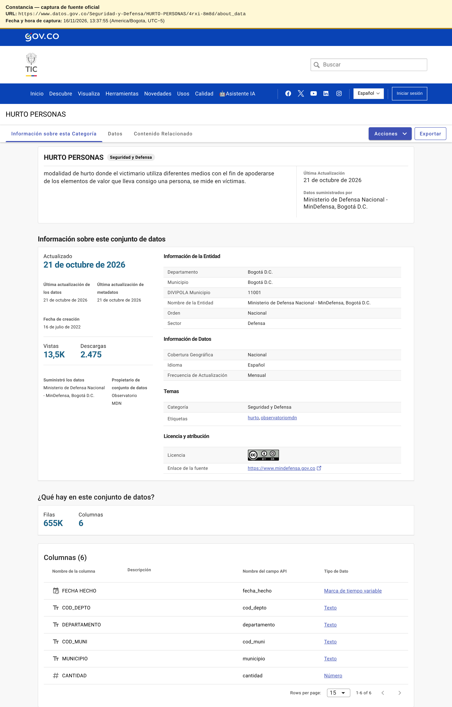
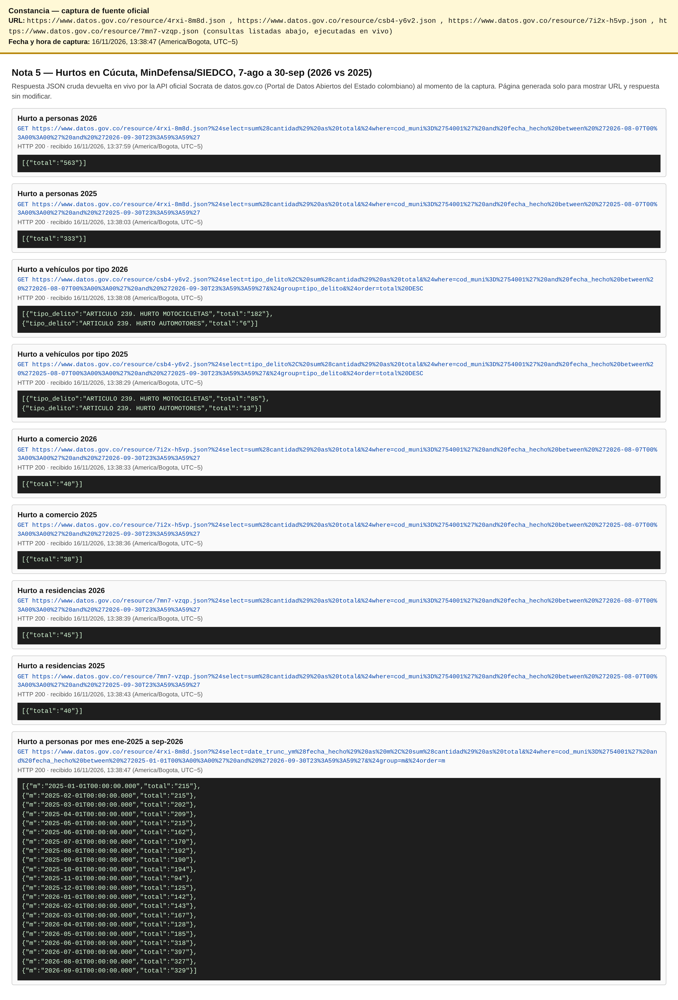
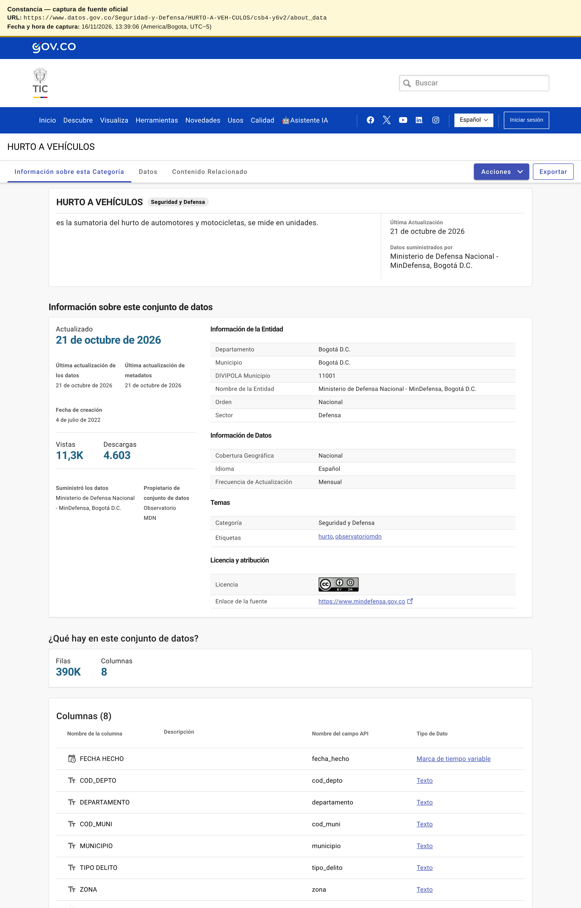

**Advertencias**
- Son delitos que dependen de la denuncia. La tasa de denuncia de Cúcuta en la ECSC 2024 del DANE (referencia 2023) fue del 24,9 %.
- Los datos de 2025 llevan un año más de maduración que los de 2026. Las cifras de 2026 tenderán a subir en próximas actualizaciones.
- El alza del hurto a personas debe leerse como «registro», no necesariamente como «incidencia».
- La Fiscalía también muestra más hurto en agosto a octubre, pero con un alza menor: +28,6 % con mismo rezago (nota 8).

---

## Nota 6. Extorsión: 21 casos frente a 36 en la Policía (−41,7 %), pero en la Fiscalía la caída se reduce a −5,6 % al igualar el rezago; secuestro en cero

**Policía (MinDefensa).** El registro de extorsión cae a **21 casos** del 7 de agosto al 30 de septiembre de 2026, frente a 36 en 2025 (−41,7 %; tasa de 2,7 frente a 4,5 por 100.000). Agosto (12) y septiembre (11) son los meses más bajos de toda la serie 2025-2026.

**Fiscalía (SPOA), agosto a octubre.** El conteo bruto también baja: 51 noticias criminales frente a 69 (−26,1 %). Pero ese contraste está sesgado: los hechos de 2025 llevan un año más para ser denunciados y registrados. Si de 2025 se cuentan solo los procesos creados hasta octubre de 2025, mismo rezago que 2026, la comparación queda en **51 frente a 54 (−5,6 %)**. El constreñimiento ilegal, delito vecino que a menudo recoge intimidaciones extorsivas, baja de 236 a 194 (−17,8 %) con el mismo control.

**Conclusión.** La dirección a la baja coincide en ambas fuentes, pero su magnitud es incierta. La caída fuerte de la Policía puede reflejar en parte menos denuncia y no solo menos extorsión.

**Secuestro.** El municipio no registra ningún caso en el periodo en la Policía (0 en ambos años). En el año hubo 2 secuestros extorsivos en 2026, en enero y febrero, frente a 4 en 2025. La Fiscalía registra 4 noticias por secuestro en agosto a octubre de 2026, frente a 3 en 2025 con mismo rezago.

| Indicador | 2025 | 2026 | Var. |
|---|---|---|---|
| Extorsión, MinDefensa, 7 ago–30 sep | 36 | 21 | −41,7 % |
| Extorsión, MinDefensa, ene–sep | 196 | 183 | −6,6 % |
| Extorsión, SPOA, hechos ago–oct (bruto) | 69 | 51 | −26,1 % |
| Extorsión, SPOA, hechos ago–oct (mismo rezago) | 54 | 51 | −5,6 % |
| Constreñimiento ilegal, SPOA (mismo rezago) | 236 | 194 | −17,8 % |
| Secuestro, MinDefensa, 7 ago–30 sep | 0 | 0 | — |
| Secuestro, SPOA, ago–oct (mismo rezago) | 3 | 4 | n. s. |

**Fuente oficial.**
- MinDefensa, «EXTORSIÓN» `q2ib-t9am` y «SECUESTRO» `d7zw-hpf4`. Corte: 30-sep-2026 (último registro de secuestro en el país: 25-sep-2026). Actualizados: 21-oct-2026.
- Fiscalía General de la Nación, «Procesos Fiscalía – V3» `dbdv-iihs`. Corte: 31-oct-2026. Actualizado: 6-nov-2026. https://www.datos.gov.co/Justicia-y-Derecho/Procesos-Fiscal-a-V3/dbdv-iihs
- Consulta: 16-nov-2026.

**Constancia**

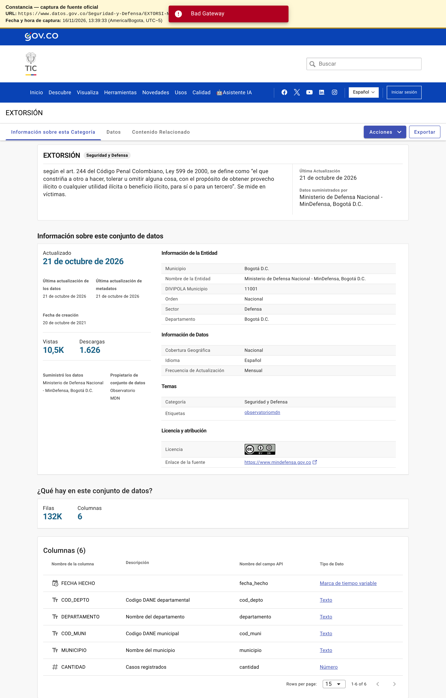
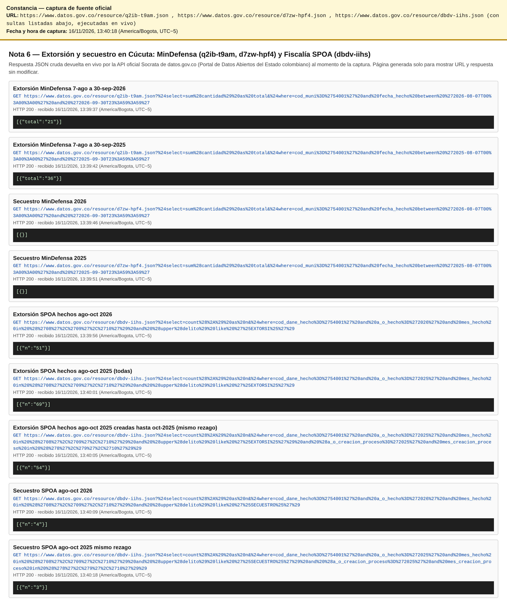
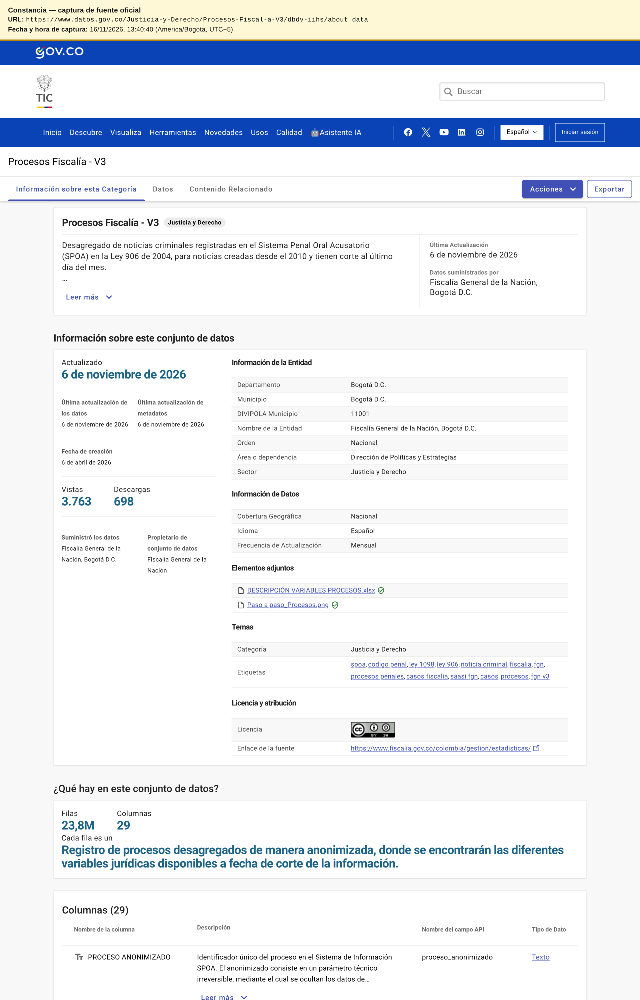

**Advertencias**
- Las unidades difieren: casos de la Policía frente a filas proceso-delito del SPOA.
- Las ventanas también: el SPOA va por mes del hecho, sin cortar el 7 de agosto.
- La extorsión tiene un alto subregistro.
- El SPOA en datos abiertos no distingue extorsión carcelaria, «gota a gota» ni la víctima (comercio o transporte).

---

## Nota 7. Violencia intrafamiliar, lesiones y delitos sexuales: la Policía registra más (+55 % VIF) y la Fiscalía menos (−13 % VIF)

**Policía (MinDefensa).** Del 7 de agosto al 30 de septiembre de 2026, los registros muestran fuertes alzas frente a 2025:
- violencia intrafamiliar (VIF): **378 frente a 244 (+54,9 %)**, tasa de 47,7 frente a 30,8 por 100.000;
- lesiones personales: **235 frente a 154 (+52,6 %)**;
- delitos sexuales: **80 frente a 70 (+14,3 %)**. En ellos sube sobre todo el número de víctimas hombres (21 frente a 10). Las mujeres siguen siendo la mayoría (54).

**Fiscalía (SPOA), agosto a octubre, con mismo rezago.** Las noticias criminales cuentan otra historia: VIF **611 frente a 705 (−13,3 %)**, lesiones dolosas **337 frente a 306 (+10,1 %)** y delitos sexuales **139 frente a 93 (+49,5 %)**.

**Por qué divergen.** La divergencia más fuerte es la de VIF y tiene una explicación probable en la serie mensual de la Policía. La VIF pasó de 41 a 76 casos al mes en el primer semestre de 2025 a 134-157 desde julio de 2025, y de nuevo a 200-240 desde mayo de 2026. Las lesiones saltaron en junio de 2026 (de 96 a 126-145 al mes). Son dos escalones de nivel que no aparecen en el SPOA, por lo que probablemente reflejan cambios en cómo SIEDCO integra denuncias, no más violencia.

**Delitos sexuales.** Aquí ocurre lo contrario: el SPOA sube más que la Policía. Es esperable, porque son delitos que se denuncian con mucho retraso y la Fiscalía recibe noticias por canales (salud, ICBF, colegios) que no pasan por la Policía.

**Conclusión.** Ninguna de las dos variaciones debe presentarse sola.

| Cúcuta | Policía 7 ago–30 sep 2025 → 2026 | Var. | SPOA hechos ago–oct, 2025 (mismo rezago) → 2026 | Var. | SPOA bruto 2025 → 2026 |
|---|---|---|---|---|---|
| Violencia intrafamiliar | 244 → 378 | +54,9 % | 705 → 611 | −13,3 % | 777 → 611 (−21,4 %) |
| Lesiones personales (dolosas) | 154 → 235 | +52,6 % | 306 → 337 | +10,1 % | 322 → 337 (+4,7 %) |
| Delitos sexuales | 70 → 80 | +14,3 % | 93 → 139 | +49,5 % | 133 → 139 (+4,5 %) |

**Fuente oficial.**
- MinDefensa, «VIOLENCIA INTRAFAMILIAR» `gepp-dxcs`, «LESIONES PERSONALES» `jr6v-i33g` y «DELITOS SEXUALES» `bz43-8ahq`. Corte: 30-sep-2026.
- Fiscalía SPOA `dbdv-iihs`. Corte: 31-oct-2026.
- Consulta: 16-nov-2026.

**Constancia**

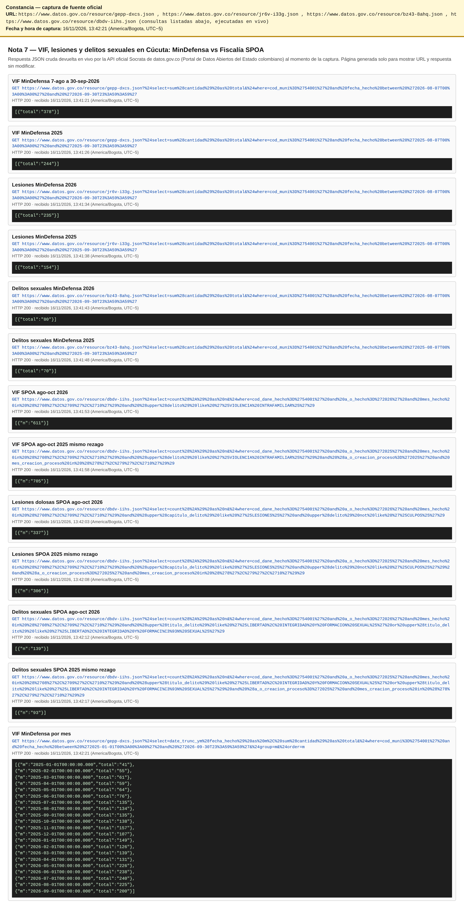

**Advertencias**
- Unidades distintas: víctimas o casos frente a proceso-delito.
- Agrupaciones del SPOA: delitos sexuales = título «Delitos contra la libertad, integridad y formación sexuales»; lesiones = capítulo de lesiones sin las culposas.
- La hipótesis del cambio de registro es una inferencia estadística, no confirmada oficialmente.

---

## Nota 8. Fiscalía (SPOA), agosto a octubre: 6.058 noticias criminales (+3,9 % con mismo rezago) y el 96,5 % sigue en indagación

**Volumen.** Por hechos ocurridos en Cúcuta entre agosto y octubre de 2026, la Fiscalía tenía al 31 de octubre **6.058 registros de noticias criminales** (Ley 906; 5.813 procesos distintos). Con mismo rezago, en 2025 eran 5.832 (+3,9 %).
- Sube el **hurto en todas sus modalidades: 1.689 frente a 1.313 (+28,6 %)**.
- Bajan las **amenazas: 284 frente a 310 (−8,4 %)**.
- Los delitos más frecuentes en 2026 son VIF (607), hurto simple de menor cuantía (509), hurto calificado (477), estafa (456) y tráfico o porte de estupefacientes (287).

**Avance judicial.** Muy limitado:
- **5.846 registros (96,5 %) siguen en indagación**, 110 en investigación, 92 en juicio y 10 en ejecución de penas.
- En **homicidio**, 10 de 117 noticias (8,5 %) han salido de indagación (8 en investigación y 2 en juicio).
- En **extorsión**, 1 de 51.
- Como referencia de maduración: los hechos de agosto a octubre de 2025, con un año más, siguen en indagación en el 96,0 % de los registros y solo el 3,4 % llegó a juicio o ejecución de penas.

**Indicio sobre octubre.** Es la única fuente oficial con dato del mes. Las noticias por **homicidio doloso consumado** (sin tentativas) suman 21 en agosto, 24 en septiembre y **22 en octubre de 2026**, frente a 51, 26 y 29 con mismo rezago en 2025. En total son **67 frente a 106 (−36,8 %)**. Sugiere que octubre no revirtió la baja, pero no es un conteo de víctimas.

| SPOA Cúcuta, hechos ago–oct | 2025 mismo rezago | 2026 | Var. |
|---|---|---|---|
| Total de registros | 5.832 | 6.058 | +3,9 % |
| Hurto (todas las modalidades) | 1.313 | 1.689 | +28,6 % |
| Amenazas | 310 | 284 | −8,4 % |
| Homicidio doloso consumado (ago / sep / oct) | 51 / 26 / 29 = 106 | 21 / 24 / 22 = 67 | −36,8 % |
| Homicidio doloso, incluidas tentativas | 182 | 117 | −35,7 % |
| Etapa de los hechos de 2026: indagación / investigación / juicio / ejecución | — | 5.846 / 110 / 92 / 10 | — |
| Registros inactivos (archivo u otra terminación) | — | 1.049 (17,3 %) | — |

**Fuente oficial.** Fiscalía General de la Nación, «Procesos Fiscalía – V3», ID `dbdv-iihs`.
- `fecha_corte_datos` = 31/10/2026. Actualizado: 6-nov-2026. Consulta: 16-nov-2026.
- https://www.datos.gov.co/Justicia-y-Derecho/Procesos-Fiscal-a-V3/dbdv-iihs

**Constancia**

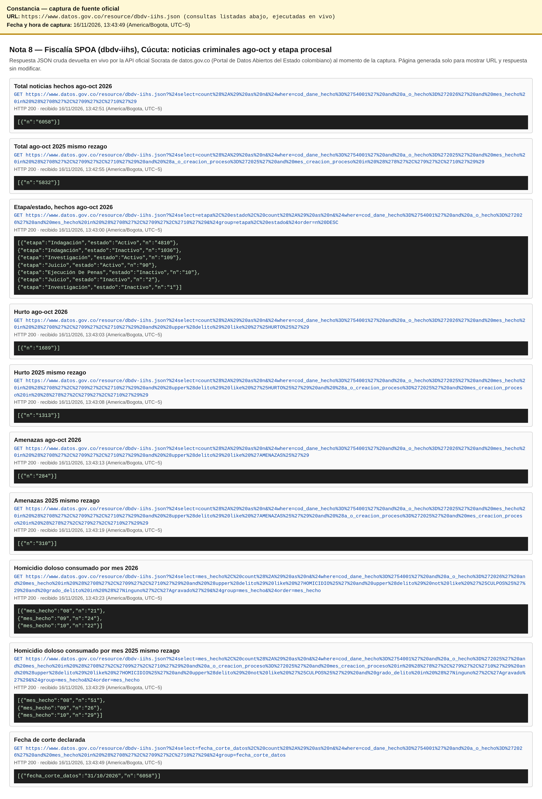

**Advertencias**
- **Unidad.** Una fila es un par proceso-delito, así que un proceso con dos delitos cuenta dos veces.
- **Octubre incompleto.** El registro de octubre de 2026 tiene a lo sumo 31 días de rezago. Por eso las comparaciones se hacen con el mismo rezago en 2025.
- **El estado procesal no mide la impunidad.** El estado procesal de 2025 corresponde a hoy, no a octubre de 2025, y mostrar el porcentaje en indagación no equivale a una tasa de impunidad.
- **Homicidio.** El homicidio del SPOA no coincide con el conteo de víctimas de la Policía. Se presenta solo como indicio de tendencia.

---

## Nota 9. Delitos asociados a estructuras criminales en la Fiscalía: estupefacientes +16 %, armas de fuego −18 %, concierto para delinquir de 1 a 5

En lugar de la nota prevista sobre líderes sociales, que no tuvo fuente oficial verificable para el periodo (ver «Vacíos»), esta nota mide en el SPOA los **delitos-firma de economías y estructuras criminales**. Período: hechos de agosto a octubre, con mismo rezago de registro.

**Cifras.**
- Tráfico, fabricación o porte de estupefacientes: **294 frente a 253 (+16,2 %)**.
- Porte o tráfico de armas de fuego, incluidas las de uso privativo: **104 frente a 127 (−18,1 %)**.
- Constreñimiento ilegal: 194 frente a 236 (−17,8 %).
- Desplazamiento forzado: estable (15 y 15).
- Concierto para delinquir: **5 frente a 1**.
- Terrorismo: 8 frente a 12.
- Trata de personas: 5 frente a 7.
- Desaparición forzada: 2 frente a 5.
- Uso de menores para delinquir: 1 y 1.

**Lectura.**
- Estupefacientes y armas son sobre todo **delitos de resultado operativo**: casi siempre nacen de capturas en flagrancia. Su alza o baja mide la actividad de la Fuerza Pública más que la incidencia del delito.
- Lo más relevante como señal de estructuras son el **desplazamiento forzado intraurbano o rural (15 noticias en tres meses)**, la persistencia de la trata y el uso de menores, y el alza del concierto para delinquir. Este último suele asociarse a imputaciones contra bandas, aunque sigue en cifras muy bajas.

| SPOA Cúcuta, hechos ago–oct | 2025 (mismo rezago) | 2026 | Var. | Tasa 2025 → 2026 (por 100.000, 3 meses) |
|---|---|---|---|---|
| Estupefacientes (art. 376) | 253 | 294 | +16,2 % | 31,9 → 37,1 |
| Armas de fuego (arts. 365 y 366) | 127 | 104 | −18,1 % | 16,0 → 13,1 |
| Constreñimiento ilegal (art. 182) | 236 | 194 | −17,8 % | 29,8 → 24,5 |
| Desplazamiento forzado (art. 180) | 15 | 15 | 0 % | 1,9 → 1,9 |
| Concierto para delinquir (art. 340) | 1 | 5 | n. s. | — |
| Terrorismo (arts. 343 y 144) | 12 | 8 | n. s. | — |
| Trata de personas (art. 188A) | 7 | 5 | n. s. | — |
| Desaparición forzada (art. 165) | 5 | 2 | n. s. | — |
| Uso de menores (art. 188D) | 1 | 1 | — | — |

**Fuente oficial.** Fiscalía General de la Nación, SPOA, `dbdv-iihs`. Filtro por el texto del delito (ver anexo). Corte: 31-oct-2026. Consulta: 16-nov-2026.

**Constancia**

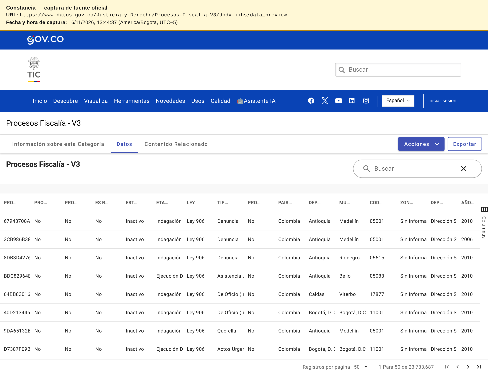
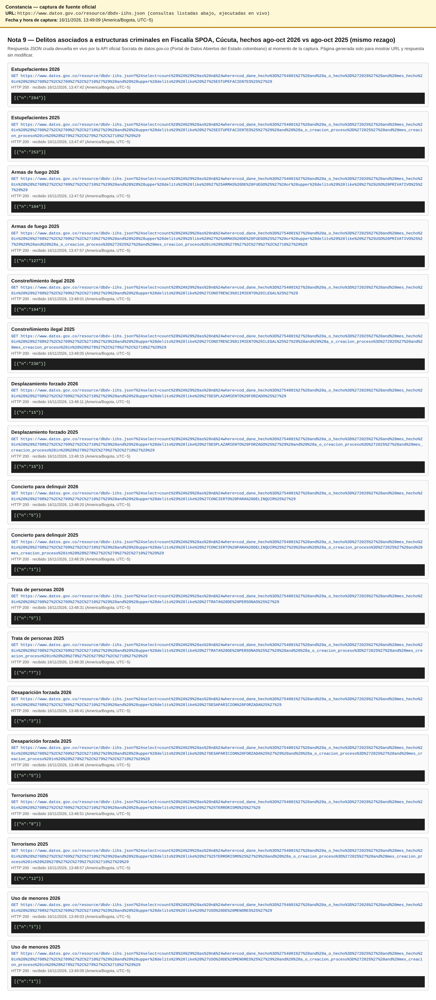

**Advertencias**
- Con conteos menores de 15, las variaciones no son significativas (n. s.).
- El SPOA abierto no identifica la estructura investigada.
- Las agrupaciones se hicieron por coincidencia de texto en la columna `delito` y pueden incluir variantes agravadas.

---

## Nota 10. Estructuras criminales y armadas en el territorio: qué dicen los registros oficiales del periodo y el marco de la Defensoría

**Marco cualitativo de la Defensoría.** El documento oficial más reciente que caracteriza a los actores en Cúcuta es el **Informe de Seguimiento 026-2026 a la Alerta Temprana 027-24** de la Defensoría del Pueblo, fechado el **8 de agosto de 2026**. Su información estadística tiene **corte anterior al periodo**: homicidios SIEDCO al 17 de junio de 2026, cuando el área metropolitana sumaba 194. Por eso se usa solo como marco cualitativo. Según el informe:
- el escenario de la AT «se materializó»;
- el **ELN** impone normas en la zona rural de Cúcuta y en Puerto Santander, y su Frente Urbano se fortalece en la ciudad;
- se consolida en Cúcuta un nuevo actor armado, el **Frente 33** (disidencia de las FARC-EP), aliado con estructuras criminales locales contra el ELN, como expansión de la guerra del Catatumbo iniciada el 16 de enero de 2025;
- en Cúcuta, Villa del Rosario y Los Patios convergen estructuras transnacionales (**Tren de Aragua y AK-47**) y bandas locales que disputan el microtráfico por comunas, entre ellas «**Los Mexicanos**» y «**La Familia P**»;
- el **EGC** (Clan del Golfo) figura en el tercer escenario de riesgo de la alerta, en Cúcuta y Villa del Rosario.

**Lo que muestran los registros oficiales del periodo.**
- **Homicidios por grupos armados:** 5 víctimas en Cúcuta «atacadas por GAO» (2 en 2025) y 2 en El Zulia. Siete en total en el área, concentradas en agosto y en zona rural (nota 3).
- **Terrorismo:** los registros caen en el área de 12 a 6, pero se desplazan de Cúcuta (9 → 1) a Los Patios (0 → 3). Hubo además 1 en El Zulia y 1 en Puerto Santander.
- **Fuerza Pública:** 7 uniformados heridos en Los Patios.
- **Fiscalía:** el concierto para delinquir sube de 1 a 5 y el desplazamiento forzado se mantiene en 15 (nota 9).

**Coherencia con el análisis de la Defensoría.** El patrón coincide con lo que describe la Defensoría: menos homicidio urbano por sicariato y más violencia de tipo armado en la periferia rural y en los municipios vecinos.

**Operación de la Fiscalía de inicios de noviembre.** Se buscó el comunicado oficial sobre la operación contra siete estructuras en el área metropolitana. **fiscalia.gov.co no respondió** el 16 de noviembre de 2026: HTTP 502, 503 o conexión reiniciada en varios intentos con navegador automatizado, curl y WebFetch. Por eso **no se incorporan cifras de esa operación**: solo estaban disponibles en prensa.

| Indicador oficial del periodo (7 ago–30 sep) | 2025 | 2026 |
|---|---|---|
| Homicidios «atacados por GAO», Cúcuta / El Zulia | 2 / 1 | 5 / 2 |
| Registros de terrorismo, área metropolitana | 12 (Cúcuta 9) | 6 (Los Patios 3, Cúcuta 1) |
| Fuerza Pública herida, área metropolitana | 1 | 7 |
| Concierto para delinquir, SPOA ago–oct (mismo rezago) | 1 | 5 |
| Desplazamiento forzado, SPOA ago–oct (mismo rezago) | 15 | 15 |

**Fuente oficial.**
- Defensoría del Pueblo, Sistema de Alertas Tempranas, Informe de Seguimiento 026-2026 (AT 027-24), fecha 08/08/2026, https://alertasstg.blob.core.windows.net/informes/302.pdf (enlace a la AT 027-24 y su comunicado: https://www.defensoria.gov.co/web/guest/w/defensoria-del-pueblo-emite-alerta-temprana-para-cucuta).
- MinDefensa `m8fd-ahd9`, `yi5j-5fe9` y `8rpn-wpty` (corte 30-sep-2026).
- Fiscalía SPOA `dbdv-iihs` (corte 31-oct-2026).
- Consulta: 16-nov-2026.

**Constancia**

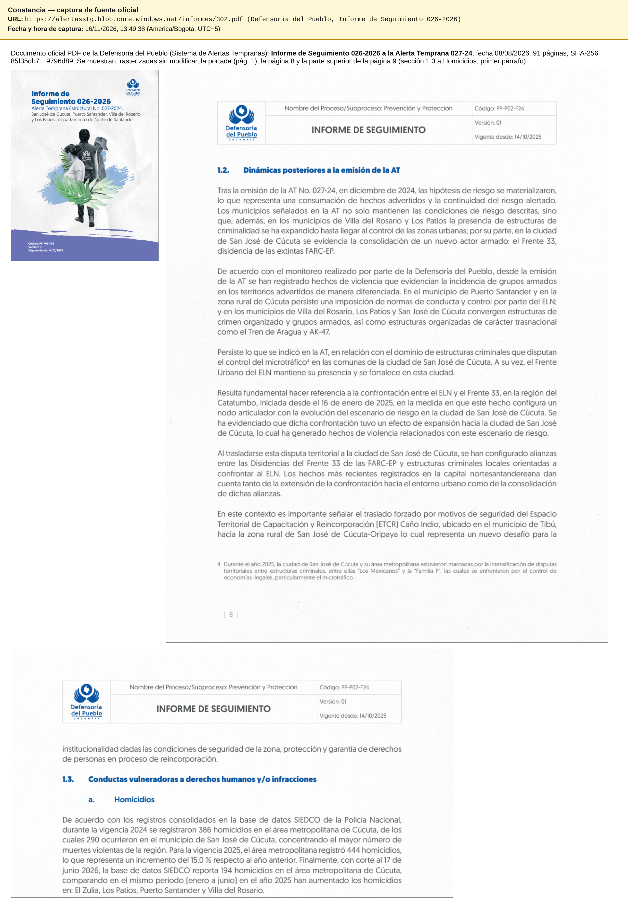
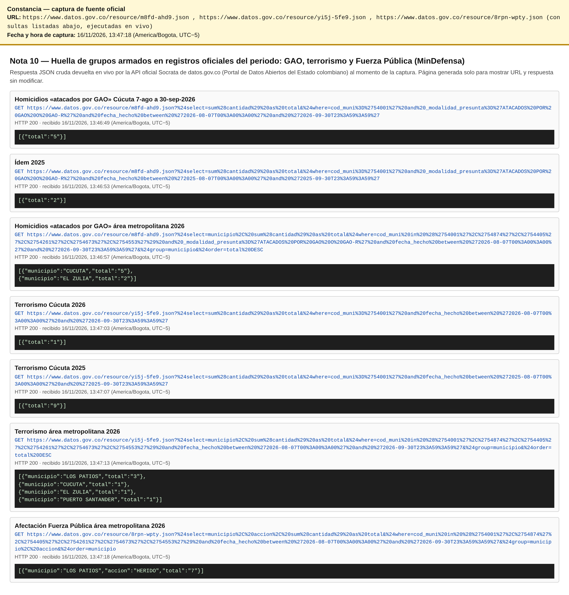
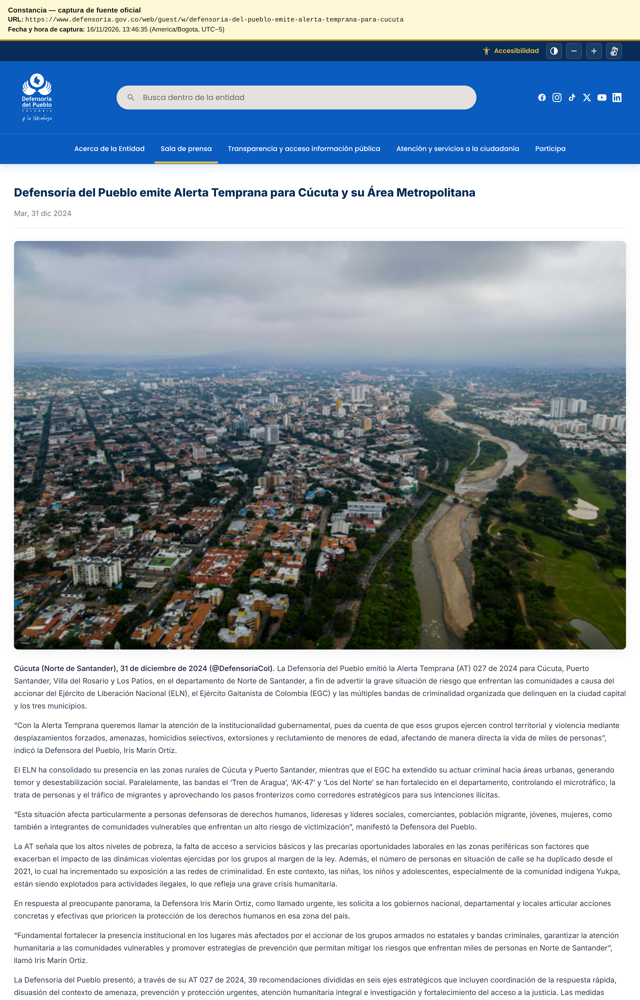

*La captura `nota10_d` (comunicado de la Fiscalía) falló: fiscalia.gov.co respondió HTTP 502.*

**Advertencias**
- La Defensoría describe actores y dinámicas con datos anteriores al 7 de agosto.
- Ningún dataset oficial abierto atribuye delitos a una estructura específica. La modalidad «GAO» de la Policía no distingue entre ELN, Frente 33 o EGC.
- Los conteos del periodo son pequeños.

---

## Vacíos de información oficial

- **Del 1 de octubre al 16 de noviembre de 2026.** No hay cifras oficiales abiertas con fecha exacta. Los datasets de MinDefensa terminan el 30 de septiembre y el SPOA el 31 de octubre, por mes. Noviembre no tiene ningún dato oficial.
- **Medicina Legal.** El dataset `2kpj-cktv` termina en julio de 2026. Los boletines mensuales en medicinalegal.gov.co devolvieron HTTP 403. No hay cifra forense del periodo.
- **Líderes sociales.** Los cortes 2026 de la Defensoría posteriores a mayo (126 asesinatos en el país al 30 de septiembre, 9 en Norte de Santander) solo se hallaron reproducidos en prensa. En defensoria.gov.co el último balance publicado es de enero a mayo de 2026 (67 en el país, 7 en Norte de Santander), anterior al periodo. Por eso se retiró la nota prevista y no se usó el contraste con Indepaz. La UNP no publica datos de protegidos o esquemas por municipio.
- **Fiscalía, comunicados.** fiscalia.gov.co no respondió (HTTP 502 o conexión reiniciada). La operación de inicios de noviembre en el área metropolitana no pudo verificarse en fuente oficial.
- **Alcaldía y Gobernación.** No se encontraron boletines de observatorio con cifras del periodo, según la búsqueda previa del 16-nov-2026.
- **Sin desagregación oficial abierta.** No la hay por comuna o barrio, por nacionalidad de la víctima, para el hurto de celulares, para la extorsión carcelaria o «gota a gota», ni para las amenazas de agosto a septiembre en MinDefensa.
- **Saltos de nivel en SIEDCO.** No hay nota técnica oficial que explique los saltos en las series de 2026: hurto a personas desde junio, VIF desde mayo y lesiones desde junio.

## Tabla de recálculo y consultas

Todas las consultas se hicieron el 16-nov-2026 contra la API Socrata oficial de datos.gov.co. Las URL completas y las respuestas JSON están en el anexo siguiente y en las capturas «b» de cada nota.

| Cifra | Dataset | Filtro principal |
|---|---|---|
| Homicidios Cúcuta, periodo y meses (notas 1 y 2) | `m8fd-ahd9` | `cod_muni='54001'`, `fecha_hecho between …`, `sum(cantidad)` |
| GAO y zona rural (nota 3) | `m8fd-ahd9` | `_modalidad_presunta='ATACADOS POR GAO O GAO-R'`, `zona='RURAL'` |
| Área metropolitana (nota 4) | `m8fd-ahd9`, `yi5j-5fe9`, `8rpn-wpty` | `cod_muni in (54001, 54874, 54405, 54261, 54673, 54553)` |
| Hurtos (nota 5) | `4rxi-8m8d`, `csb4-y6v2`, `7i2x-h5vp`, `7mn7-vzqp` | `cod_muni='54001'`, grupo `tipo_delito` |
| Extorsión y secuestro (nota 6) | `q2ib-t9am`, `d7zw-hpf4`, `dbdv-iihs` | SPOA: `cod_dane_hecho='54001'`, `a_o_hecho`, `mes_hecho in ('08','09','10')`, mismo rezago con `a_o_creacion_proceso` y `mes_creacion_proceso` |
| VIF, lesiones, sexuales (nota 7) | `gepp-dxcs`, `jr6v-i33g`, `bz43-8ahq`, `dbdv-iihs` | ídem |
| SPOA general y etapas (nota 8) | `dbdv-iihs` | grupo `etapa`, `estado`; homicidio con `grado_delito in ('Ninguno','Agravado')` |
| Delitos-firma (nota 9) | `dbdv-iihs` | `upper(delito) like …` |
| Población | DANE PPED-AreaMun-2018-2042_VP.xlsx | hoja PobMunicipalxÁrea, años 2025 y 2026 |

### Cambios frente a las notas de investigación previas

1. **Comparaciones del SPOA.** Ahora se hacen con mismo rezago de registro, lo que cambia varias variaciones de agosto a octubre:

   | Delito | Antes | Ahora |
   |---|---|---|
   | Extorsión | −26,1 % | **−5,6 %** |
   | VIF | −21,4 % | **−13,3 %** |
   | Hurto | +16,6 % | **+28,6 %** |
   | Amenazas | −17,7 % | **−8,4 %** |
   | Lesiones | +4,3 % | **+10,1 %** |
   | Delitos sexuales | +3,0 % | **+49,5 %** |

   Las cifras brutas también variaron levemente:
   - lesiones 2025: 322, antes 323 (actualización del dataset);
   - delitos sexuales 2026: 139, antes 136, porque ahora se agrupan por título del Código Penal.

2. **Últimos registros de datasets.** El último registro de secuestro es del 25-sep-2026 (las notas previas decían 21-sep). El de afectación a la Fuerza Pública llega al 30-sep-2026 (antes, 31-ago).

3. **Cifras que se confirman.** Se confirmaron sin cambios:
   - homicidios: 49 frente a 59; 28 frente a 33; 21 frente a 26;
   - área metropolitana: 60 frente a 72;
   - GAO: 5 frente a 2 en el periodo y 38 frente a 8 en el año;
   - las cifras de hurto, extorsión, VIF, lesiones, delitos sexuales y terrorismo de MinDefensa;
   - la población DANE, ahora verificada en el archivo oficial y no en un sitio secundario.

4. **Notas retiradas o modificadas.**
   - Se retiró la nota de líderes sociales (sin fuente oficial verificable del periodo) y se reemplazó por la nota 9.
   - La operación de la Fiscalía de noviembre no se usa como base porque su comunicado oficial no cargó.

## Anexo. URL exactas de las consultas a la API oficial (16-nov-2026)

Cada URL devuelve, en formato JSON, el conteo citado. Las respuestas obtenidas en vivo aparecen en las capturas «b» (y «a» de la nota 3). Ejecutadas entre las 13:33 y las 13:49 (America/Bogota).

**nota01_b** — Nota 1 — Homicidios en Cúcuta (cod_muni 54001), MinDefensa/SIEDCO, dataset m8fd-ahd9

- 7-ago a 30-sep-2026 (suma de víctimas): `https://www.datos.gov.co/resource/m8fd-ahd9.json?%24select=sum%28cantidad%29%20as%20total&%24where=cod_muni%3D%2754001%27%20and%20fecha_hecho%20between%20%272026-08-07T00%3A00%3A00%27%20and%20%272026-09-30T23%3A59%3A59%27`
- 7-ago a 30-sep-2025: `https://www.datos.gov.co/resource/m8fd-ahd9.json?%24select=sum%28cantidad%29%20as%20total&%24where=cod_muni%3D%2754001%27%20and%20fecha_hecho%20between%20%272025-08-07T00%3A00%3A00%27%20and%20%272025-09-30T23%3A59%3A59%27`
- 7 a 31-ago-2026: `https://www.datos.gov.co/resource/m8fd-ahd9.json?%24select=sum%28cantidad%29%20as%20total&%24where=cod_muni%3D%2754001%27%20and%20fecha_hecho%20between%20%272026-08-07T00%3A00%3A00%27%20and%20%272026-08-31T23%3A59%3A59%27`
- 7 a 31-ago-2025: `https://www.datos.gov.co/resource/m8fd-ahd9.json?%24select=sum%28cantidad%29%20as%20total&%24where=cod_muni%3D%2754001%27%20and%20fecha_hecho%20between%20%272025-08-07T00%3A00%3A00%27%20and%20%272025-08-31T23%3A59%3A59%27`
- 1 a 30-sep-2026: `https://www.datos.gov.co/resource/m8fd-ahd9.json?%24select=sum%28cantidad%29%20as%20total&%24where=cod_muni%3D%2754001%27%20and%20fecha_hecho%20between%20%272026-09-01T00%3A00%3A00%27%20and%20%272026-09-30T23%3A59%3A59%27`
- 1 a 30-sep-2025: `https://www.datos.gov.co/resource/m8fd-ahd9.json?%24select=sum%28cantidad%29%20as%20total&%24where=cod_muni%3D%2754001%27%20and%20fecha_hecho%20between%20%272025-09-01T00%3A00%3A00%27%20and%20%272025-09-30T23%3A59%3A59%27`
- Ene a sep 2026: `https://www.datos.gov.co/resource/m8fd-ahd9.json?%24select=sum%28cantidad%29%20as%20total&%24where=cod_muni%3D%2754001%27%20and%20fecha_hecho%20between%20%272026-01-01T00%3A00%3A00%27%20and%20%272026-09-30T23%3A59%3A59%27`
- Ene a sep 2025: `https://www.datos.gov.co/resource/m8fd-ahd9.json?%24select=sum%28cantidad%29%20as%20total&%24where=cod_muni%3D%2754001%27%20and%20fecha_hecho%20between%20%272025-01-01T00%3A00%3A00%27%20and%20%272025-09-30T23%3A59%3A59%27`
- Fecha máxima del dataset (fecha de corte): `https://www.datos.gov.co/resource/m8fd-ahd9.json?%24select=max%28fecha_hecho%29%20as%20maxf`

**nota02_b** — Nota 2 — Homicidios en Cúcuta por arma, modalidad, sexo, zona y caracterización SPOA, 7-ago a 30-sep (2026 vs 2025)

- Arma/medio 2026: `https://www.datos.gov.co/resource/m8fd-ahd9.json?%24select=arma_medio%2C%20sum%28cantidad%29%20as%20total&%24where=cod_muni%3D%2754001%27%20and%20fecha_hecho%20between%20%272026-08-07T00%3A00%3A00%27%20and%20%272026-09-30T23%3A59%3A59%27&%24group=arma_medio&%24order=total%20DESC`
- Arma/medio 2025: `https://www.datos.gov.co/resource/m8fd-ahd9.json?%24select=arma_medio%2C%20sum%28cantidad%29%20as%20total&%24where=cod_muni%3D%2754001%27%20and%20fecha_hecho%20between%20%272025-08-07T00%3A00%3A00%27%20and%20%272025-09-30T23%3A59%3A59%27&%24group=arma_medio&%24order=total%20DESC`
- Modalidad presunta 2026: `https://www.datos.gov.co/resource/m8fd-ahd9.json?%24select=_modalidad_presunta%2C%20sum%28cantidad%29%20as%20total&%24where=cod_muni%3D%2754001%27%20and%20fecha_hecho%20between%20%272026-08-07T00%3A00%3A00%27%20and%20%272026-09-30T23%3A59%3A59%27&%24group=_modalidad_presunta&%24order=total%20DESC`
- Modalidad presunta 2025: `https://www.datos.gov.co/resource/m8fd-ahd9.json?%24select=_modalidad_presunta%2C%20sum%28cantidad%29%20as%20total&%24where=cod_muni%3D%2754001%27%20and%20fecha_hecho%20between%20%272025-08-07T00%3A00%3A00%27%20and%20%272025-09-30T23%3A59%3A59%27&%24group=_modalidad_presunta&%24order=total%20DESC`
- Sexo 2026: `https://www.datos.gov.co/resource/m8fd-ahd9.json?%24select=sexo%2C%20sum%28cantidad%29%20as%20total&%24where=cod_muni%3D%2754001%27%20and%20fecha_hecho%20between%20%272026-08-07T00%3A00%3A00%27%20and%20%272026-09-30T23%3A59%3A59%27&%24group=sexo&%24order=total%20DESC`
- Sexo 2025: `https://www.datos.gov.co/resource/m8fd-ahd9.json?%24select=sexo%2C%20sum%28cantidad%29%20as%20total&%24where=cod_muni%3D%2754001%27%20and%20fecha_hecho%20between%20%272025-08-07T00%3A00%3A00%27%20and%20%272025-09-30T23%3A59%3A59%27&%24group=sexo&%24order=total%20DESC`
- Zona 2026: `https://www.datos.gov.co/resource/m8fd-ahd9.json?%24select=zona%2C%20sum%28cantidad%29%20as%20total&%24where=cod_muni%3D%2754001%27%20and%20fecha_hecho%20between%20%272026-08-07T00%3A00%3A00%27%20and%20%272026-09-30T23%3A59%3A59%27&%24group=zona&%24order=total%20DESC`
- Zona 2025: `https://www.datos.gov.co/resource/m8fd-ahd9.json?%24select=zona%2C%20sum%28cantidad%29%20as%20total&%24where=cod_muni%3D%2754001%27%20and%20fecha_hecho%20between%20%272025-08-07T00%3A00%3A00%27%20and%20%272025-09-30T23%3A59%3A59%27&%24group=zona&%24order=total%20DESC`
- Caracterización SPOA 2026: `https://www.datos.gov.co/resource/m8fd-ahd9.json?%24select=spoa_caracterizacion%2C%20sum%28cantidad%29%20as%20total&%24where=cod_muni%3D%2754001%27%20and%20fecha_hecho%20between%20%272026-08-07T00%3A00%3A00%27%20and%20%272026-09-30T23%3A59%3A59%27&%24group=spoa_caracterizacion&%24order=total%20DESC`
- Caracterización SPOA 2025: `https://www.datos.gov.co/resource/m8fd-ahd9.json?%24select=spoa_caracterizacion%2C%20sum%28cantidad%29%20as%20total&%24where=cod_muni%3D%2754001%27%20and%20fecha_hecho%20between%20%272025-08-07T00%3A00%3A00%27%20and%20%272025-09-30T23%3A59%3A59%27&%24group=spoa_caracterizacion&%24order=total%20DESC`

**nota03_a** — Nota 3 — Registros individuales: homicidios en Cúcuta con modalidad «ATACADOS POR GAO O GAO-R», 7-ago a 30-sep-2026

- Filas del dataset (una fila por fecha/zona/sexo/arma/modalidad): `https://www.datos.gov.co/resource/m8fd-ahd9.json?%24where=cod_muni%3D%2754001%27%20and%20_modalidad_presunta%3D%27ATACADOS%20POR%20GAO%20O%20GAO-R%27%20and%20fecha_hecho%20between%20%272026-08-07T00%3A00%3A00%27%20and%20%272026-09-30T23%3A59%3A59%27&%24order=fecha_hecho`

**nota03_b** — Nota 3 — Homicidios «atacados por GAO o GAO-R» y homicidios rurales: Cúcuta, área metropolitana y Norte de Santander

- GAO Cúcuta 7-ago a 30-sep-2026: `https://www.datos.gov.co/resource/m8fd-ahd9.json?%24select=sum%28cantidad%29%20as%20total&%24where=cod_muni%3D%2754001%27%20and%20_modalidad_presunta%3D%27ATACADOS%20POR%20GAO%20O%20GAO-R%27%20and%20fecha_hecho%20between%20%272026-08-07T00%3A00%3A00%27%20and%20%272026-09-30T23%3A59%3A59%27`
- GAO Cúcuta 7-ago a 30-sep-2025: `https://www.datos.gov.co/resource/m8fd-ahd9.json?%24select=sum%28cantidad%29%20as%20total&%24where=cod_muni%3D%2754001%27%20and%20_modalidad_presunta%3D%27ATACADOS%20POR%20GAO%20O%20GAO-R%27%20and%20fecha_hecho%20between%20%272025-08-07T00%3A00%3A00%27%20and%20%272025-09-30T23%3A59%3A59%27`
- GAO Cúcuta ene-sep 2026: `https://www.datos.gov.co/resource/m8fd-ahd9.json?%24select=sum%28cantidad%29%20as%20total&%24where=cod_muni%3D%2754001%27%20and%20_modalidad_presunta%3D%27ATACADOS%20POR%20GAO%20O%20GAO-R%27%20and%20fecha_hecho%20between%20%272026-01-01T00%3A00%3A00%27%20and%20%272026-09-30T23%3A59%3A59%27`
- GAO Cúcuta ene-sep 2025: `https://www.datos.gov.co/resource/m8fd-ahd9.json?%24select=sum%28cantidad%29%20as%20total&%24where=cod_muni%3D%2754001%27%20and%20_modalidad_presunta%3D%27ATACADOS%20POR%20GAO%20O%20GAO-R%27%20and%20fecha_hecho%20between%20%272025-01-01T00%3A00%3A00%27%20and%20%272025-09-30T23%3A59%3A59%27`
- Rural Cúcuta 7-ago a 30-sep-2026: `https://www.datos.gov.co/resource/m8fd-ahd9.json?%24select=sum%28cantidad%29%20as%20total&%24where=cod_muni%3D%2754001%27%20and%20zona%3D%27RURAL%27%20and%20fecha_hecho%20between%20%272026-08-07T00%3A00%3A00%27%20and%20%272026-09-30T23%3A59%3A59%27`
- Rural Cúcuta 7-ago a 30-sep-2025: `https://www.datos.gov.co/resource/m8fd-ahd9.json?%24select=sum%28cantidad%29%20as%20total&%24where=cod_muni%3D%2754001%27%20and%20zona%3D%27RURAL%27%20and%20fecha_hecho%20between%20%272025-08-07T00%3A00%3A00%27%20and%20%272025-09-30T23%3A59%3A59%27`
- Rural Cúcuta ene-sep 2026: `https://www.datos.gov.co/resource/m8fd-ahd9.json?%24select=sum%28cantidad%29%20as%20total&%24where=cod_muni%3D%2754001%27%20and%20zona%3D%27RURAL%27%20and%20fecha_hecho%20between%20%272026-01-01T00%3A00%3A00%27%20and%20%272026-09-30T23%3A59%3A59%27`
- Rural Cúcuta ene-sep 2025: `https://www.datos.gov.co/resource/m8fd-ahd9.json?%24select=sum%28cantidad%29%20as%20total&%24where=cod_muni%3D%2754001%27%20and%20zona%3D%27RURAL%27%20and%20fecha_hecho%20between%20%272025-01-01T00%3A00%3A00%27%20and%20%272025-09-30T23%3A59%3A59%27`
- GAO por mes Cúcuta 2026: `https://www.datos.gov.co/resource/m8fd-ahd9.json?%24select=date_trunc_ym%28fecha_hecho%29%20as%20m%2C%20sum%28cantidad%29%20as%20total&%24where=cod_muni%3D%2754001%27%20and%20_modalidad_presunta%3D%27ATACADOS%20POR%20GAO%20O%20GAO-R%27%20and%20fecha_hecho%20between%20%272026-01-01T00%3A00%3A00%27%20and%20%272026-09-30T23%3A59%3A59%27&%24group=m&%24order=m`
- GAO por mes Cúcuta 2025: `https://www.datos.gov.co/resource/m8fd-ahd9.json?%24select=date_trunc_ym%28fecha_hecho%29%20as%20m%2C%20sum%28cantidad%29%20as%20total&%24where=cod_muni%3D%2754001%27%20and%20_modalidad_presunta%3D%27ATACADOS%20POR%20GAO%20O%20GAO-R%27%20and%20fecha_hecho%20between%20%272025-01-01T00%3A00%3A00%27%20and%20%272025-12-31T23%3A59%3A59%27&%24group=m&%24order=m`
- GAO área metropolitana 2026 (periodo): `https://www.datos.gov.co/resource/m8fd-ahd9.json?%24select=municipio%2C%20sum%28cantidad%29%20as%20total&%24where=cod_muni%20in%20%28%2754001%27%2C%2754874%27%2C%2754405%27%2C%2754261%27%2C%2754673%27%2C%2754553%27%29%20and%20_modalidad_presunta%3D%27ATACADOS%20POR%20GAO%20O%20GAO-R%27%20and%20fecha_hecho%20between%20%272026-08-07T00%3A00%3A00%27%20and%20%272026-09-30T23%3A59%3A59%27&%24group=municipio&%24order=total%20DESC`
- GAO área metropolitana 2025 (periodo): `https://www.datos.gov.co/resource/m8fd-ahd9.json?%24select=municipio%2C%20sum%28cantidad%29%20as%20total&%24where=cod_muni%20in%20%28%2754001%27%2C%2754874%27%2C%2754405%27%2C%2754261%27%2C%2754673%27%2C%2754553%27%29%20and%20_modalidad_presunta%3D%27ATACADOS%20POR%20GAO%20O%20GAO-R%27%20and%20fecha_hecho%20between%20%272025-08-07T00%3A00%3A00%27%20and%20%272025-09-30T23%3A59%3A59%27&%24group=municipio&%24order=total%20DESC`
- GAO Norte de Santander 2026 (periodo): `https://www.datos.gov.co/resource/m8fd-ahd9.json?%24select=sum%28cantidad%29%20as%20total&%24where=cod_depto%3D%2754%27%20and%20_modalidad_presunta%3D%27ATACADOS%20POR%20GAO%20O%20GAO-R%27%20and%20fecha_hecho%20between%20%272026-08-07T00%3A00%3A00%27%20and%20%272026-09-30T23%3A59%3A59%27`
- GAO Norte de Santander 2025 (periodo): `https://www.datos.gov.co/resource/m8fd-ahd9.json?%24select=sum%28cantidad%29%20as%20total&%24where=cod_depto%3D%2754%27%20and%20_modalidad_presunta%3D%27ATACADOS%20POR%20GAO%20O%20GAO-R%27%20and%20fecha_hecho%20between%20%272025-08-07T00%3A00%3A00%27%20and%20%272025-09-30T23%3A59%3A59%27`

**nota04_b** — Nota 4 — Homicidios y terrorismo por municipio del área metropolitana de Cúcuta, 7-ago a 30-sep (2026 vs 2025)

- Homicidios por municipio 2026: `https://www.datos.gov.co/resource/m8fd-ahd9.json?%24select=municipio%2C%20sum%28cantidad%29%20as%20total&%24where=cod_muni%20in%20%28%2754001%27%2C%2754874%27%2C%2754405%27%2C%2754261%27%2C%2754673%27%2C%2754553%27%29%20and%20fecha_hecho%20between%20%272026-08-07T00%3A00%3A00%27%20and%20%272026-09-30T23%3A59%3A59%27&%24group=municipio&%24order=total%20DESC`
- Homicidios por municipio 2025: `https://www.datos.gov.co/resource/m8fd-ahd9.json?%24select=municipio%2C%20sum%28cantidad%29%20as%20total&%24where=cod_muni%20in%20%28%2754001%27%2C%2754874%27%2C%2754405%27%2C%2754261%27%2C%2754673%27%2C%2754553%27%29%20and%20fecha_hecho%20between%20%272025-08-07T00%3A00%3A00%27%20and%20%272025-09-30T23%3A59%3A59%27&%24group=municipio&%24order=total%20DESC`
- Homicidios ene-sep 2026: `https://www.datos.gov.co/resource/m8fd-ahd9.json?%24select=municipio%2C%20sum%28cantidad%29%20as%20total&%24where=cod_muni%20in%20%28%2754001%27%2C%2754874%27%2C%2754405%27%2C%2754261%27%2C%2754673%27%2C%2754553%27%29%20and%20fecha_hecho%20between%20%272026-01-01T00%3A00%3A00%27%20and%20%272026-09-30T23%3A59%3A59%27&%24group=municipio&%24order=total%20DESC`
- Homicidios ene-sep 2025: `https://www.datos.gov.co/resource/m8fd-ahd9.json?%24select=municipio%2C%20sum%28cantidad%29%20as%20total&%24where=cod_muni%20in%20%28%2754001%27%2C%2754874%27%2C%2754405%27%2C%2754261%27%2C%2754673%27%2C%2754553%27%29%20and%20fecha_hecho%20between%20%272025-01-01T00%3A00%3A00%27%20and%20%272025-09-30T23%3A59%3A59%27&%24group=municipio&%24order=total%20DESC`
- Terrorismo (yi5j-5fe9) por municipio 2026: `https://www.datos.gov.co/resource/yi5j-5fe9.json?%24select=municipio%2C%20sum%28cantidad%29%20as%20total&%24where=cod_muni%20in%20%28%2754001%27%2C%2754874%27%2C%2754405%27%2C%2754261%27%2C%2754673%27%2C%2754553%27%29%20and%20fecha_hecho%20between%20%272026-08-07T00%3A00%3A00%27%20and%20%272026-09-30T23%3A59%3A59%27&%24group=municipio&%24order=total%20DESC`
- Terrorismo por municipio 2025: `https://www.datos.gov.co/resource/yi5j-5fe9.json?%24select=municipio%2C%20sum%28cantidad%29%20as%20total&%24where=cod_muni%20in%20%28%2754001%27%2C%2754874%27%2C%2754405%27%2C%2754261%27%2C%2754673%27%2C%2754553%27%29%20and%20fecha_hecho%20between%20%272025-08-07T00%3A00%3A00%27%20and%20%272025-09-30T23%3A59%3A59%27&%24group=municipio&%24order=total%20DESC`
- Afectación a miembros de la Fuerza Pública (8rpn-wpty) 2026: `https://www.datos.gov.co/resource/8rpn-wpty.json?%24select=municipio%2C%20accion%2C%20sum%28cantidad%29%20as%20total&%24where=cod_muni%20in%20%28%2754001%27%2C%2754874%27%2C%2754405%27%2C%2754261%27%2C%2754673%27%2C%2754553%27%29%20and%20fecha_hecho%20between%20%272026-08-07T00%3A00%3A00%27%20and%20%272026-09-30T23%3A59%3A59%27&%24group=municipio%2C%20accion&%24order=municipio`
- Afectación Fuerza Pública 2025: `https://www.datos.gov.co/resource/8rpn-wpty.json?%24select=municipio%2C%20accion%2C%20sum%28cantidad%29%20as%20total&%24where=cod_muni%20in%20%28%2754001%27%2C%2754874%27%2C%2754405%27%2C%2754261%27%2C%2754673%27%2C%2754553%27%29%20and%20fecha_hecho%20between%20%272025-08-07T00%3A00%3A00%27%20and%20%272025-09-30T23%3A59%3A59%27&%24group=municipio%2C%20accion&%24order=municipio`

**nota05_b** — Nota 5 — Hurtos en Cúcuta, MinDefensa/SIEDCO, 7-ago a 30-sep (2026 vs 2025)

- Hurto a personas 2026: `https://www.datos.gov.co/resource/4rxi-8m8d.json?%24select=sum%28cantidad%29%20as%20total&%24where=cod_muni%3D%2754001%27%20and%20fecha_hecho%20between%20%272026-08-07T00%3A00%3A00%27%20and%20%272026-09-30T23%3A59%3A59%27`
- Hurto a personas 2025: `https://www.datos.gov.co/resource/4rxi-8m8d.json?%24select=sum%28cantidad%29%20as%20total&%24where=cod_muni%3D%2754001%27%20and%20fecha_hecho%20between%20%272025-08-07T00%3A00%3A00%27%20and%20%272025-09-30T23%3A59%3A59%27`
- Hurto a vehículos por tipo 2026: `https://www.datos.gov.co/resource/csb4-y6v2.json?%24select=tipo_delito%2C%20sum%28cantidad%29%20as%20total&%24where=cod_muni%3D%2754001%27%20and%20fecha_hecho%20between%20%272026-08-07T00%3A00%3A00%27%20and%20%272026-09-30T23%3A59%3A59%27&%24group=tipo_delito&%24order=total%20DESC`
- Hurto a vehículos por tipo 2025: `https://www.datos.gov.co/resource/csb4-y6v2.json?%24select=tipo_delito%2C%20sum%28cantidad%29%20as%20total&%24where=cod_muni%3D%2754001%27%20and%20fecha_hecho%20between%20%272025-08-07T00%3A00%3A00%27%20and%20%272025-09-30T23%3A59%3A59%27&%24group=tipo_delito&%24order=total%20DESC`
- Hurto a comercio 2026: `https://www.datos.gov.co/resource/7i2x-h5vp.json?%24select=sum%28cantidad%29%20as%20total&%24where=cod_muni%3D%2754001%27%20and%20fecha_hecho%20between%20%272026-08-07T00%3A00%3A00%27%20and%20%272026-09-30T23%3A59%3A59%27`
- Hurto a comercio 2025: `https://www.datos.gov.co/resource/7i2x-h5vp.json?%24select=sum%28cantidad%29%20as%20total&%24where=cod_muni%3D%2754001%27%20and%20fecha_hecho%20between%20%272025-08-07T00%3A00%3A00%27%20and%20%272025-09-30T23%3A59%3A59%27`
- Hurto a residencias 2026: `https://www.datos.gov.co/resource/7mn7-vzqp.json?%24select=sum%28cantidad%29%20as%20total&%24where=cod_muni%3D%2754001%27%20and%20fecha_hecho%20between%20%272026-08-07T00%3A00%3A00%27%20and%20%272026-09-30T23%3A59%3A59%27`
- Hurto a residencias 2025: `https://www.datos.gov.co/resource/7mn7-vzqp.json?%24select=sum%28cantidad%29%20as%20total&%24where=cod_muni%3D%2754001%27%20and%20fecha_hecho%20between%20%272025-08-07T00%3A00%3A00%27%20and%20%272025-09-30T23%3A59%3A59%27`
- Hurto a personas por mes ene-2025 a sep-2026: `https://www.datos.gov.co/resource/4rxi-8m8d.json?%24select=date_trunc_ym%28fecha_hecho%29%20as%20m%2C%20sum%28cantidad%29%20as%20total&%24where=cod_muni%3D%2754001%27%20and%20fecha_hecho%20between%20%272025-01-01T00%3A00%3A00%27%20and%20%272026-09-30T23%3A59%3A59%27&%24group=m&%24order=m`

**nota06_b** — Nota 6 — Extorsión y secuestro en Cúcuta: MinDefensa (q2ib-t9am, d7zw-hpf4) y Fiscalía SPOA (dbdv-iihs)

- Extorsión MinDefensa 7-ago a 30-sep-2026: `https://www.datos.gov.co/resource/q2ib-t9am.json?%24select=sum%28cantidad%29%20as%20total&%24where=cod_muni%3D%2754001%27%20and%20fecha_hecho%20between%20%272026-08-07T00%3A00%3A00%27%20and%20%272026-09-30T23%3A59%3A59%27`
- Extorsión MinDefensa 7-ago a 30-sep-2025: `https://www.datos.gov.co/resource/q2ib-t9am.json?%24select=sum%28cantidad%29%20as%20total&%24where=cod_muni%3D%2754001%27%20and%20fecha_hecho%20between%20%272025-08-07T00%3A00%3A00%27%20and%20%272025-09-30T23%3A59%3A59%27`
- Secuestro MinDefensa 2026: `https://www.datos.gov.co/resource/d7zw-hpf4.json?%24select=sum%28cantidad%29%20as%20total&%24where=cod_muni%3D%2754001%27%20and%20fecha_hecho%20between%20%272026-08-07T00%3A00%3A00%27%20and%20%272026-09-30T23%3A59%3A59%27`
- Secuestro MinDefensa 2025: `https://www.datos.gov.co/resource/d7zw-hpf4.json?%24select=sum%28cantidad%29%20as%20total&%24where=cod_muni%3D%2754001%27%20and%20fecha_hecho%20between%20%272025-08-07T00%3A00%3A00%27%20and%20%272025-09-30T23%3A59%3A59%27`
- Extorsión SPOA hechos ago-oct 2026: `https://www.datos.gov.co/resource/dbdv-iihs.json?%24select=count%28%2A%29%20as%20n&%24where=cod_dane_hecho%3D%2754001%27%20and%20a_o_hecho%3D%272026%27%20and%20mes_hecho%20in%20%28%2708%27%2C%2709%27%2C%2710%27%29%20and%20%28upper%28delito%29%20like%20%27%25EXTORSI%25%27%29`
- Extorsión SPOA hechos ago-oct 2025 (todas): `https://www.datos.gov.co/resource/dbdv-iihs.json?%24select=count%28%2A%29%20as%20n&%24where=cod_dane_hecho%3D%2754001%27%20and%20a_o_hecho%3D%272025%27%20and%20mes_hecho%20in%20%28%2708%27%2C%2709%27%2C%2710%27%29%20and%20%28upper%28delito%29%20like%20%27%25EXTORSI%25%27%29`
- Extorsión SPOA hechos ago-oct 2025 creadas hasta oct-2025 (mismo rezago): `https://www.datos.gov.co/resource/dbdv-iihs.json?%24select=count%28%2A%29%20as%20n&%24where=cod_dane_hecho%3D%2754001%27%20and%20a_o_hecho%3D%272025%27%20and%20mes_hecho%20in%20%28%2708%27%2C%2709%27%2C%2710%27%29%20and%20%28upper%28delito%29%20like%20%27%25EXTORSI%25%27%29%20and%20%28a_o_creacion_proceso%3D%272025%27%20and%20mes_creacion_proceso%20in%20%28%278%27%2C%279%27%2C%2710%27%29%29`
- Secuestro SPOA ago-oct 2026: `https://www.datos.gov.co/resource/dbdv-iihs.json?%24select=count%28%2A%29%20as%20n&%24where=cod_dane_hecho%3D%2754001%27%20and%20a_o_hecho%3D%272026%27%20and%20mes_hecho%20in%20%28%2708%27%2C%2709%27%2C%2710%27%29%20and%20%28upper%28delito%29%20like%20%27%25SECUESTRO%25%27%29`
- Secuestro SPOA ago-oct 2025 mismo rezago: `https://www.datos.gov.co/resource/dbdv-iihs.json?%24select=count%28%2A%29%20as%20n&%24where=cod_dane_hecho%3D%2754001%27%20and%20a_o_hecho%3D%272025%27%20and%20mes_hecho%20in%20%28%2708%27%2C%2709%27%2C%2710%27%29%20and%20%28upper%28delito%29%20like%20%27%25SECUESTRO%25%27%29%20and%20%28a_o_creacion_proceso%3D%272025%27%20and%20mes_creacion_proceso%20in%20%28%278%27%2C%279%27%2C%2710%27%29%29`

**nota07_b** — Nota 7 — VIF, lesiones y delitos sexuales en Cúcuta: MinDefensa vs Fiscalía SPOA

- VIF MinDefensa 7-ago a 30-sep-2026: `https://www.datos.gov.co/resource/gepp-dxcs.json?%24select=sum%28cantidad%29%20as%20total&%24where=cod_muni%3D%2754001%27%20and%20fecha_hecho%20between%20%272026-08-07T00%3A00%3A00%27%20and%20%272026-09-30T23%3A59%3A59%27`
- VIF MinDefensa 2025: `https://www.datos.gov.co/resource/gepp-dxcs.json?%24select=sum%28cantidad%29%20as%20total&%24where=cod_muni%3D%2754001%27%20and%20fecha_hecho%20between%20%272025-08-07T00%3A00%3A00%27%20and%20%272025-09-30T23%3A59%3A59%27`
- Lesiones MinDefensa 2026: `https://www.datos.gov.co/resource/jr6v-i33g.json?%24select=sum%28cantidad%29%20as%20total&%24where=cod_muni%3D%2754001%27%20and%20fecha_hecho%20between%20%272026-08-07T00%3A00%3A00%27%20and%20%272026-09-30T23%3A59%3A59%27`
- Lesiones MinDefensa 2025: `https://www.datos.gov.co/resource/jr6v-i33g.json?%24select=sum%28cantidad%29%20as%20total&%24where=cod_muni%3D%2754001%27%20and%20fecha_hecho%20between%20%272025-08-07T00%3A00%3A00%27%20and%20%272025-09-30T23%3A59%3A59%27`
- Delitos sexuales MinDefensa 2026: `https://www.datos.gov.co/resource/bz43-8ahq.json?%24select=sum%28cantidad%29%20as%20total&%24where=cod_muni%3D%2754001%27%20and%20fecha_hecho%20between%20%272026-08-07T00%3A00%3A00%27%20and%20%272026-09-30T23%3A59%3A59%27`
- Delitos sexuales MinDefensa 2025: `https://www.datos.gov.co/resource/bz43-8ahq.json?%24select=sum%28cantidad%29%20as%20total&%24where=cod_muni%3D%2754001%27%20and%20fecha_hecho%20between%20%272025-08-07T00%3A00%3A00%27%20and%20%272025-09-30T23%3A59%3A59%27`
- VIF SPOA ago-oct 2026: `https://www.datos.gov.co/resource/dbdv-iihs.json?%24select=count%28%2A%29%20as%20n&%24where=cod_dane_hecho%3D%2754001%27%20and%20a_o_hecho%3D%272026%27%20and%20mes_hecho%20in%20%28%2708%27%2C%2709%27%2C%2710%27%29%20and%20%28upper%28delito%29%20like%20%27%25VIOLENCIA%20INTRAFAMILIAR%25%27%29`
- VIF SPOA ago-oct 2025 mismo rezago: `https://www.datos.gov.co/resource/dbdv-iihs.json?%24select=count%28%2A%29%20as%20n&%24where=cod_dane_hecho%3D%2754001%27%20and%20a_o_hecho%3D%272025%27%20and%20mes_hecho%20in%20%28%2708%27%2C%2709%27%2C%2710%27%29%20and%20%28upper%28delito%29%20like%20%27%25VIOLENCIA%20INTRAFAMILIAR%25%27%29%20and%20%28a_o_creacion_proceso%3D%272025%27%20and%20mes_creacion_proceso%20in%20%28%278%27%2C%279%27%2C%2710%27%29%29`
- Lesiones dolosas SPOA ago-oct 2026: `https://www.datos.gov.co/resource/dbdv-iihs.json?%24select=count%28%2A%29%20as%20n&%24where=cod_dane_hecho%3D%2754001%27%20and%20a_o_hecho%3D%272026%27%20and%20mes_hecho%20in%20%28%2708%27%2C%2709%27%2C%2710%27%29%20and%20%28upper%28capitulo_delito%29%20like%20%27%25LESIONES%25%27%20and%20upper%28delito%29%20not%20like%20%27%25CULPOS%25%27%29`
- Lesiones SPOA 2025 mismo rezago: `https://www.datos.gov.co/resource/dbdv-iihs.json?%24select=count%28%2A%29%20as%20n&%24where=cod_dane_hecho%3D%2754001%27%20and%20a_o_hecho%3D%272025%27%20and%20mes_hecho%20in%20%28%2708%27%2C%2709%27%2C%2710%27%29%20and%20%28upper%28capitulo_delito%29%20like%20%27%25LESIONES%25%27%20and%20upper%28delito%29%20not%20like%20%27%25CULPOS%25%27%29%20and%20%28a_o_creacion_proceso%3D%272025%27%20and%20mes_creacion_proceso%20in%20%28%278%27%2C%279%27%2C%2710%27%29%29`
- Delitos sexuales SPOA ago-oct 2026: `https://www.datos.gov.co/resource/dbdv-iihs.json?%24select=count%28%2A%29%20as%20n&%24where=cod_dane_hecho%3D%2754001%27%20and%20a_o_hecho%3D%272026%27%20and%20mes_hecho%20in%20%28%2708%27%2C%2709%27%2C%2710%27%29%20and%20%28upper%28titulo_delito%29%20like%20%27%25LIBERTAD%2C%20INTEGRIDAD%20Y%20FORMACION%20SEXUAL%25%27%20or%20upper%28titulo_delito%29%20like%20%27%25LIBERTAD%2C%20INTEGRIDAD%20Y%20FORMACI%C3%93N%20SEXUAL%25%27%29`
- Delitos sexuales SPOA 2025 mismo rezago: `https://www.datos.gov.co/resource/dbdv-iihs.json?%24select=count%28%2A%29%20as%20n&%24where=cod_dane_hecho%3D%2754001%27%20and%20a_o_hecho%3D%272025%27%20and%20mes_hecho%20in%20%28%2708%27%2C%2709%27%2C%2710%27%29%20and%20%28upper%28titulo_delito%29%20like%20%27%25LIBERTAD%2C%20INTEGRIDAD%20Y%20FORMACION%20SEXUAL%25%27%20or%20upper%28titulo_delito%29%20like%20%27%25LIBERTAD%2C%20INTEGRIDAD%20Y%20FORMACI%C3%93N%20SEXUAL%25%27%29%20and%20%28a_o_creacion_proceso%3D%272025%27%20and%20mes_creacion_proceso%20in%20%28%278%27%2C%279%27%2C%2710%27%29%29`
- VIF MinDefensa por mes: `https://www.datos.gov.co/resource/gepp-dxcs.json?%24select=date_trunc_ym%28fecha_hecho%29%20as%20m%2C%20sum%28cantidad%29%20as%20total&%24where=cod_muni%3D%2754001%27%20and%20fecha_hecho%20between%20%272025-01-01T00%3A00%3A00%27%20and%20%272026-09-30T23%3A59%3A59%27&%24group=m&%24order=m`

**nota08_b** — Nota 8 — Fiscalía SPOA (dbdv-iihs), Cúcuta: noticias criminales ago-oct y etapa procesal

- Total noticias hechos ago-oct 2026: `https://www.datos.gov.co/resource/dbdv-iihs.json?%24select=count%28%2A%29%20as%20n&%24where=cod_dane_hecho%3D%2754001%27%20and%20a_o_hecho%3D%272026%27%20and%20mes_hecho%20in%20%28%2708%27%2C%2709%27%2C%2710%27%29`
- Total ago-oct 2025 mismo rezago: `https://www.datos.gov.co/resource/dbdv-iihs.json?%24select=count%28%2A%29%20as%20n&%24where=cod_dane_hecho%3D%2754001%27%20and%20a_o_hecho%3D%272025%27%20and%20mes_hecho%20in%20%28%2708%27%2C%2709%27%2C%2710%27%29%20and%20%28a_o_creacion_proceso%3D%272025%27%20and%20mes_creacion_proceso%20in%20%28%278%27%2C%279%27%2C%2710%27%29%29`
- Etapa/estado, hechos ago-oct 2026: `https://www.datos.gov.co/resource/dbdv-iihs.json?%24select=etapa%2C%20estado%2C%20count%28%2A%29%20as%20n&%24where=cod_dane_hecho%3D%2754001%27%20and%20a_o_hecho%3D%272026%27%20and%20mes_hecho%20in%20%28%2708%27%2C%2709%27%2C%2710%27%29&%24group=etapa%2C%20estado&%24order=n%20DESC`
- Hurto ago-oct 2026: `https://www.datos.gov.co/resource/dbdv-iihs.json?%24select=count%28%2A%29%20as%20n&%24where=cod_dane_hecho%3D%2754001%27%20and%20a_o_hecho%3D%272026%27%20and%20mes_hecho%20in%20%28%2708%27%2C%2709%27%2C%2710%27%29%20and%20%28upper%28delito%29%20like%20%27%25HURTO%25%27%29`
- Hurto 2025 mismo rezago: `https://www.datos.gov.co/resource/dbdv-iihs.json?%24select=count%28%2A%29%20as%20n&%24where=cod_dane_hecho%3D%2754001%27%20and%20a_o_hecho%3D%272025%27%20and%20mes_hecho%20in%20%28%2708%27%2C%2709%27%2C%2710%27%29%20and%20%28upper%28delito%29%20like%20%27%25HURTO%25%27%29%20and%20%28a_o_creacion_proceso%3D%272025%27%20and%20mes_creacion_proceso%20in%20%28%278%27%2C%279%27%2C%2710%27%29%29`
- Amenazas ago-oct 2026: `https://www.datos.gov.co/resource/dbdv-iihs.json?%24select=count%28%2A%29%20as%20n&%24where=cod_dane_hecho%3D%2754001%27%20and%20a_o_hecho%3D%272026%27%20and%20mes_hecho%20in%20%28%2708%27%2C%2709%27%2C%2710%27%29%20and%20%28upper%28delito%29%20like%20%27AMENAZAS%25%27%29`
- Amenazas 2025 mismo rezago: `https://www.datos.gov.co/resource/dbdv-iihs.json?%24select=count%28%2A%29%20as%20n&%24where=cod_dane_hecho%3D%2754001%27%20and%20a_o_hecho%3D%272025%27%20and%20mes_hecho%20in%20%28%2708%27%2C%2709%27%2C%2710%27%29%20and%20%28upper%28delito%29%20like%20%27AMENAZAS%25%27%29%20and%20%28a_o_creacion_proceso%3D%272025%27%20and%20mes_creacion_proceso%20in%20%28%278%27%2C%279%27%2C%2710%27%29%29`
- Homicidio doloso consumado por mes 2026: `https://www.datos.gov.co/resource/dbdv-iihs.json?%24select=mes_hecho%2C%20count%28%2A%29%20as%20n&%24where=cod_dane_hecho%3D%2754001%27%20and%20a_o_hecho%3D%272026%27%20and%20mes_hecho%20in%20%28%2708%27%2C%2709%27%2C%2710%27%29%20and%20%28upper%28delito%29%20like%20%27HOMICIDIO%25%27%20and%20upper%28delito%29%20not%20like%20%27%25CULPOS%25%27%29%20and%20grado_delito%20in%20%28%27Ninguno%27%2C%27Agravado%27%29&%24group=mes_hecho&%24order=mes_hecho`
- Homicidio doloso consumado por mes 2025 mismo rezago: `https://www.datos.gov.co/resource/dbdv-iihs.json?%24select=mes_hecho%2C%20count%28%2A%29%20as%20n&%24where=cod_dane_hecho%3D%2754001%27%20and%20a_o_hecho%3D%272025%27%20and%20mes_hecho%20in%20%28%2708%27%2C%2709%27%2C%2710%27%29%20and%20a_o_creacion_proceso%3D%272025%27%20and%20mes_creacion_proceso%20in%20%28%278%27%2C%279%27%2C%2710%27%29%20and%20%28upper%28delito%29%20like%20%27HOMICIDIO%25%27%20and%20upper%28delito%29%20not%20like%20%27%25CULPOS%25%27%29%20and%20grado_delito%20in%20%28%27Ninguno%27%2C%27Agravado%27%29&%24group=mes_hecho&%24order=mes_hecho`
- Fecha de corte declarada: `https://www.datos.gov.co/resource/dbdv-iihs.json?%24select=fecha_corte_datos%2C%20count%28%2A%29%20as%20n&%24where=cod_dane_hecho%3D%2754001%27%20and%20a_o_hecho%3D%272026%27%20and%20mes_hecho%20in%20%28%2708%27%2C%2709%27%2C%2710%27%29&%24group=fecha_corte_datos`

**nota09_b** — Nota 9 — Delitos asociados a estructuras criminales en Fiscalía SPOA, Cúcuta, hechos ago-oct 2026 vs ago-oct 2025 (mismo rezago)

- Estupefacientes 2026: `https://www.datos.gov.co/resource/dbdv-iihs.json?%24select=count%28%2A%29%20as%20n&%24where=cod_dane_hecho%3D%2754001%27%20and%20a_o_hecho%3D%272026%27%20and%20mes_hecho%20in%20%28%2708%27%2C%2709%27%2C%2710%27%29%20and%20%28upper%28delito%29%20like%20%27%25ESTUPEFACIENTES%25%27%29`
- Estupefacientes 2025: `https://www.datos.gov.co/resource/dbdv-iihs.json?%24select=count%28%2A%29%20as%20n&%24where=cod_dane_hecho%3D%2754001%27%20and%20a_o_hecho%3D%272025%27%20and%20mes_hecho%20in%20%28%2708%27%2C%2709%27%2C%2710%27%29%20and%20%28upper%28delito%29%20like%20%27%25ESTUPEFACIENTES%25%27%29%20and%20%28a_o_creacion_proceso%3D%272025%27%20and%20mes_creacion_proceso%20in%20%28%278%27%2C%279%27%2C%2710%27%29%29`
- Armas de fuego 2026: `https://www.datos.gov.co/resource/dbdv-iihs.json?%24select=count%28%2A%29%20as%20n&%24where=cod_dane_hecho%3D%2754001%27%20and%20a_o_hecho%3D%272026%27%20and%20mes_hecho%20in%20%28%2708%27%2C%2709%27%2C%2710%27%29%20and%20%28%28upper%28delito%29%20like%20%27%25ARMAS%20DE%20FUEGO%25%27%20or%20upper%28delito%29%20like%20%27%25USO%20PRIVATIVO%25%27%29%29`
- Armas de fuego 2025: `https://www.datos.gov.co/resource/dbdv-iihs.json?%24select=count%28%2A%29%20as%20n&%24where=cod_dane_hecho%3D%2754001%27%20and%20a_o_hecho%3D%272025%27%20and%20mes_hecho%20in%20%28%2708%27%2C%2709%27%2C%2710%27%29%20and%20%28%28upper%28delito%29%20like%20%27%25ARMAS%20DE%20FUEGO%25%27%20or%20upper%28delito%29%20like%20%27%25USO%20PRIVATIVO%25%27%29%29%20and%20%28a_o_creacion_proceso%3D%272025%27%20and%20mes_creacion_proceso%20in%20%28%278%27%2C%279%27%2C%2710%27%29%29`
- Constreñimiento ilegal 2026: `https://www.datos.gov.co/resource/dbdv-iihs.json?%24select=count%28%2A%29%20as%20n&%24where=cod_dane_hecho%3D%2754001%27%20and%20a_o_hecho%3D%272026%27%20and%20mes_hecho%20in%20%28%2708%27%2C%2709%27%2C%2710%27%29%20and%20%28upper%28delito%29%20like%20%27CONSTRE%C3%91IMIENTO%20ILEGAL%25%27%29`
- Constreñimiento ilegal 2025: `https://www.datos.gov.co/resource/dbdv-iihs.json?%24select=count%28%2A%29%20as%20n&%24where=cod_dane_hecho%3D%2754001%27%20and%20a_o_hecho%3D%272025%27%20and%20mes_hecho%20in%20%28%2708%27%2C%2709%27%2C%2710%27%29%20and%20%28upper%28delito%29%20like%20%27CONSTRE%C3%91IMIENTO%20ILEGAL%25%27%29%20and%20%28a_o_creacion_proceso%3D%272025%27%20and%20mes_creacion_proceso%20in%20%28%278%27%2C%279%27%2C%2710%27%29%29`
- Desplazamiento forzado 2026: `https://www.datos.gov.co/resource/dbdv-iihs.json?%24select=count%28%2A%29%20as%20n&%24where=cod_dane_hecho%3D%2754001%27%20and%20a_o_hecho%3D%272026%27%20and%20mes_hecho%20in%20%28%2708%27%2C%2709%27%2C%2710%27%29%20and%20%28upper%28delito%29%20like%20%27DESPLAZAMIENTO%20FORZADO%25%27%29`
- Desplazamiento forzado 2025: `https://www.datos.gov.co/resource/dbdv-iihs.json?%24select=count%28%2A%29%20as%20n&%24where=cod_dane_hecho%3D%2754001%27%20and%20a_o_hecho%3D%272025%27%20and%20mes_hecho%20in%20%28%2708%27%2C%2709%27%2C%2710%27%29%20and%20%28upper%28delito%29%20like%20%27DESPLAZAMIENTO%20FORZADO%25%27%29%20and%20%28a_o_creacion_proceso%3D%272025%27%20and%20mes_creacion_proceso%20in%20%28%278%27%2C%279%27%2C%2710%27%29%29`
- Concierto para delinquir 2026: `https://www.datos.gov.co/resource/dbdv-iihs.json?%24select=count%28%2A%29%20as%20n&%24where=cod_dane_hecho%3D%2754001%27%20and%20a_o_hecho%3D%272026%27%20and%20mes_hecho%20in%20%28%2708%27%2C%2709%27%2C%2710%27%29%20and%20%28upper%28delito%29%20like%20%27CONCIERTO%20PARA%20DELINQUIR%25%27%29`
- Concierto para delinquir 2025: `https://www.datos.gov.co/resource/dbdv-iihs.json?%24select=count%28%2A%29%20as%20n&%24where=cod_dane_hecho%3D%2754001%27%20and%20a_o_hecho%3D%272025%27%20and%20mes_hecho%20in%20%28%2708%27%2C%2709%27%2C%2710%27%29%20and%20%28upper%28delito%29%20like%20%27CONCIERTO%20PARA%20DELINQUIR%25%27%29%20and%20%28a_o_creacion_proceso%3D%272025%27%20and%20mes_creacion_proceso%20in%20%28%278%27%2C%279%27%2C%2710%27%29%29`
- Trata de personas 2026: `https://www.datos.gov.co/resource/dbdv-iihs.json?%24select=count%28%2A%29%20as%20n&%24where=cod_dane_hecho%3D%2754001%27%20and%20a_o_hecho%3D%272026%27%20and%20mes_hecho%20in%20%28%2708%27%2C%2709%27%2C%2710%27%29%20and%20%28upper%28delito%29%20like%20%27TRATA%20DE%20PERSONAS%25%27%29`
- Trata de personas 2025: `https://www.datos.gov.co/resource/dbdv-iihs.json?%24select=count%28%2A%29%20as%20n&%24where=cod_dane_hecho%3D%2754001%27%20and%20a_o_hecho%3D%272025%27%20and%20mes_hecho%20in%20%28%2708%27%2C%2709%27%2C%2710%27%29%20and%20%28upper%28delito%29%20like%20%27TRATA%20DE%20PERSONAS%25%27%29%20and%20%28a_o_creacion_proceso%3D%272025%27%20and%20mes_creacion_proceso%20in%20%28%278%27%2C%279%27%2C%2710%27%29%29`
- Desaparición forzada 2026: `https://www.datos.gov.co/resource/dbdv-iihs.json?%24select=count%28%2A%29%20as%20n&%24where=cod_dane_hecho%3D%2754001%27%20and%20a_o_hecho%3D%272026%27%20and%20mes_hecho%20in%20%28%2708%27%2C%2709%27%2C%2710%27%29%20and%20%28upper%28delito%29%20like%20%27DESAPARICION%20FORZADA%25%27%29`
- Desaparición forzada 2025: `https://www.datos.gov.co/resource/dbdv-iihs.json?%24select=count%28%2A%29%20as%20n&%24where=cod_dane_hecho%3D%2754001%27%20and%20a_o_hecho%3D%272025%27%20and%20mes_hecho%20in%20%28%2708%27%2C%2709%27%2C%2710%27%29%20and%20%28upper%28delito%29%20like%20%27DESAPARICION%20FORZADA%25%27%29%20and%20%28a_o_creacion_proceso%3D%272025%27%20and%20mes_creacion_proceso%20in%20%28%278%27%2C%279%27%2C%2710%27%29%29`
- Terrorismo 2026: `https://www.datos.gov.co/resource/dbdv-iihs.json?%24select=count%28%2A%29%20as%20n&%24where=cod_dane_hecho%3D%2754001%27%20and%20a_o_hecho%3D%272026%27%20and%20mes_hecho%20in%20%28%2708%27%2C%2709%27%2C%2710%27%29%20and%20%28upper%28delito%29%20like%20%27%25TERRORISMO%25%27%29`
- Terrorismo 2025: `https://www.datos.gov.co/resource/dbdv-iihs.json?%24select=count%28%2A%29%20as%20n&%24where=cod_dane_hecho%3D%2754001%27%20and%20a_o_hecho%3D%272025%27%20and%20mes_hecho%20in%20%28%2708%27%2C%2709%27%2C%2710%27%29%20and%20%28upper%28delito%29%20like%20%27%25TERRORISMO%25%27%29%20and%20%28a_o_creacion_proceso%3D%272025%27%20and%20mes_creacion_proceso%20in%20%28%278%27%2C%279%27%2C%2710%27%29%29`
- Uso de menores 2026: `https://www.datos.gov.co/resource/dbdv-iihs.json?%24select=count%28%2A%29%20as%20n&%24where=cod_dane_hecho%3D%2754001%27%20and%20a_o_hecho%3D%272026%27%20and%20mes_hecho%20in%20%28%2708%27%2C%2709%27%2C%2710%27%29%20and%20%28upper%28delito%29%20like%20%27USO%20DE%20MENORES%25%27%29`
- Uso de menores 2025: `https://www.datos.gov.co/resource/dbdv-iihs.json?%24select=count%28%2A%29%20as%20n&%24where=cod_dane_hecho%3D%2754001%27%20and%20a_o_hecho%3D%272025%27%20and%20mes_hecho%20in%20%28%2708%27%2C%2709%27%2C%2710%27%29%20and%20%28upper%28delito%29%20like%20%27USO%20DE%20MENORES%25%27%29%20and%20%28a_o_creacion_proceso%3D%272025%27%20and%20mes_creacion_proceso%20in%20%28%278%27%2C%279%27%2C%2710%27%29%29`

**nota10_b** — Nota 10 — Huella de grupos armados en registros oficiales del periodo: GAO, terrorismo y Fuerza Pública (MinDefensa)

- Homicidios «atacados por GAO» Cúcuta 7-ago a 30-sep-2026: `https://www.datos.gov.co/resource/m8fd-ahd9.json?%24select=sum%28cantidad%29%20as%20total&%24where=cod_muni%3D%2754001%27%20and%20_modalidad_presunta%3D%27ATACADOS%20POR%20GAO%20O%20GAO-R%27%20and%20fecha_hecho%20between%20%272026-08-07T00%3A00%3A00%27%20and%20%272026-09-30T23%3A59%3A59%27`
- Ídem 2025: `https://www.datos.gov.co/resource/m8fd-ahd9.json?%24select=sum%28cantidad%29%20as%20total&%24where=cod_muni%3D%2754001%27%20and%20_modalidad_presunta%3D%27ATACADOS%20POR%20GAO%20O%20GAO-R%27%20and%20fecha_hecho%20between%20%272025-08-07T00%3A00%3A00%27%20and%20%272025-09-30T23%3A59%3A59%27`
- Homicidios «atacados por GAO» área metropolitana 2026: `https://www.datos.gov.co/resource/m8fd-ahd9.json?%24select=municipio%2C%20sum%28cantidad%29%20as%20total&%24where=cod_muni%20in%20%28%2754001%27%2C%2754874%27%2C%2754405%27%2C%2754261%27%2C%2754673%27%2C%2754553%27%29%20and%20_modalidad_presunta%3D%27ATACADOS%20POR%20GAO%20O%20GAO-R%27%20and%20fecha_hecho%20between%20%272026-08-07T00%3A00%3A00%27%20and%20%272026-09-30T23%3A59%3A59%27&%24group=municipio&%24order=total%20DESC`
- Terrorismo Cúcuta 2026: `https://www.datos.gov.co/resource/yi5j-5fe9.json?%24select=sum%28cantidad%29%20as%20total&%24where=cod_muni%3D%2754001%27%20and%20fecha_hecho%20between%20%272026-08-07T00%3A00%3A00%27%20and%20%272026-09-30T23%3A59%3A59%27`
- Terrorismo Cúcuta 2025: `https://www.datos.gov.co/resource/yi5j-5fe9.json?%24select=sum%28cantidad%29%20as%20total&%24where=cod_muni%3D%2754001%27%20and%20fecha_hecho%20between%20%272025-08-07T00%3A00%3A00%27%20and%20%272025-09-30T23%3A59%3A59%27`
- Terrorismo área metropolitana 2026: `https://www.datos.gov.co/resource/yi5j-5fe9.json?%24select=municipio%2C%20sum%28cantidad%29%20as%20total&%24where=cod_muni%20in%20%28%2754001%27%2C%2754874%27%2C%2754405%27%2C%2754261%27%2C%2754673%27%2C%2754553%27%29%20and%20fecha_hecho%20between%20%272026-08-07T00%3A00%3A00%27%20and%20%272026-09-30T23%3A59%3A59%27&%24group=municipio&%24order=total%20DESC`
- Afectación Fuerza Pública área metropolitana 2026: `https://www.datos.gov.co/resource/8rpn-wpty.json?%24select=municipio%2C%20accion%2C%20sum%28cantidad%29%20as%20total&%24where=cod_muni%20in%20%28%2754001%27%2C%2754874%27%2C%2754405%27%2C%2754261%27%2C%2754673%27%2C%2754553%27%29%20and%20fecha_hecho%20between%20%272026-08-07T00%3A00%3A00%27%20and%20%272026-09-30T23%3A59%3A59%27&%24group=municipio%2C%20accion&%24order=municipio`

